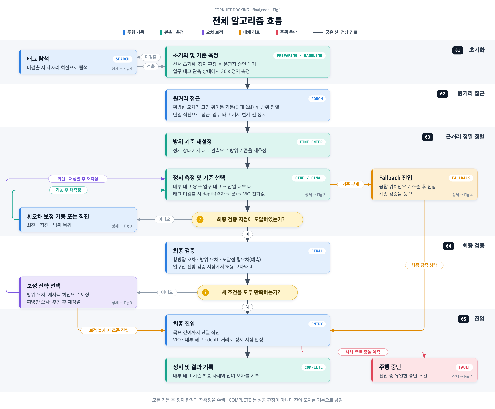
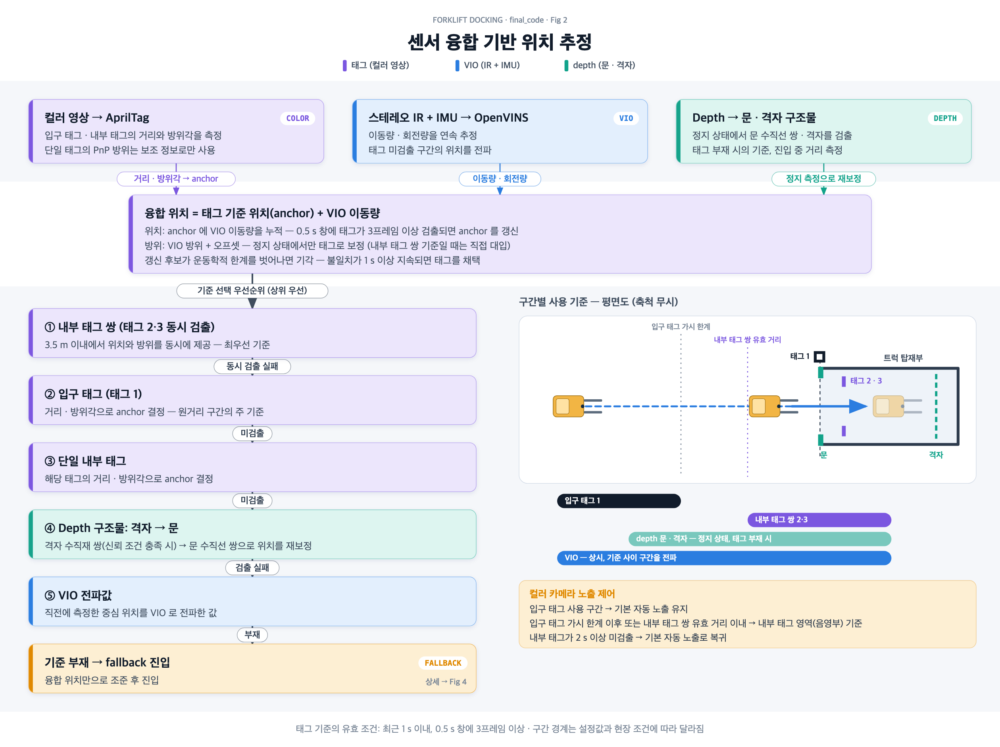
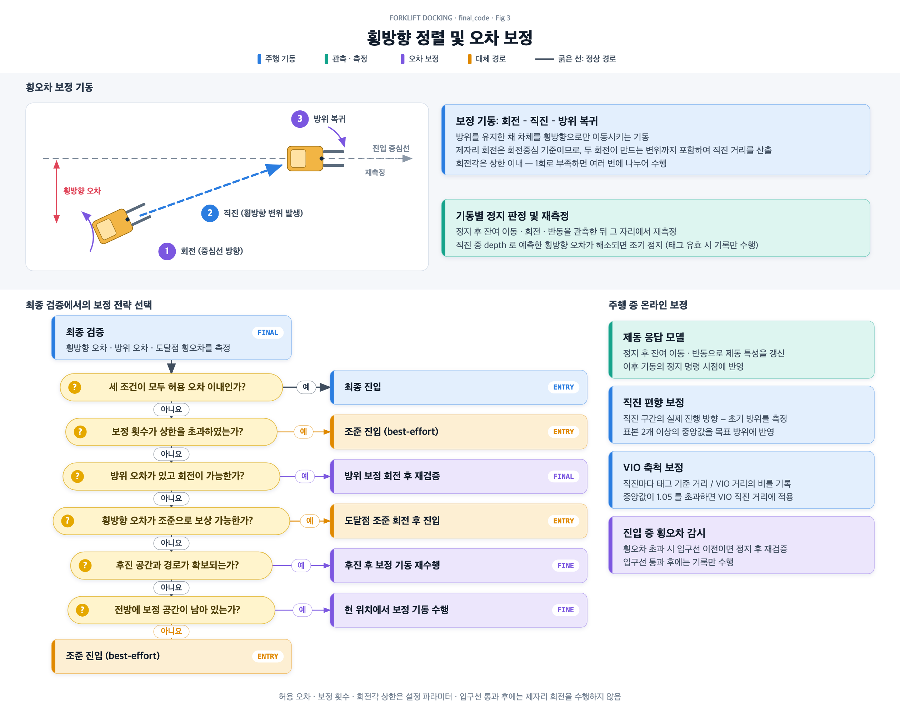
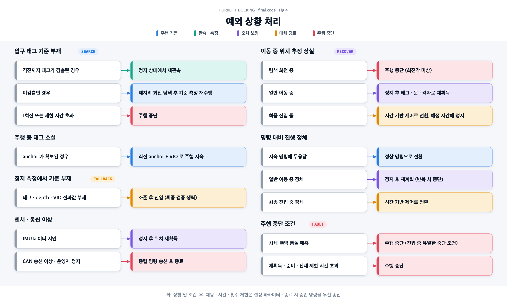

# Forklift Docking — `final_code`

지게차를 트럭 탑재부 입구에 정렬하고 포크 끝을 목표 깊이까지 진입시키는 자율 도킹 시스템이다. AprilTag 기반 절대 위치 측정, visual-inertial odometry(VIO, 영상과 관성 센서로 상대 이동량을 추정하는 기법), depth 기반 구조물 검출을 융합하여 차량 자세를 추정한다. 제어는 사전에 계획한 경로를 추종하지 않고, 기동을 마칠 때마다 정지 상태에서 자세를 재측정하여 다음 기동을 결정하는 측정 기반 순차 구조를 따른다.

본문의 수치는 현재 설정(`final_code/configs/common.json`)을 기준으로 한다.

## 1. 시스템 구성

### 1.1 하드웨어

| 구성 요소 | 사양 및 역할 |
|---|---|
| 연산 장치 | Jetson Orin Nano (Ubuntu 24.04, ROS 2 Jazzy) |
| 카메라 | Intel RealSense D435i. 컬러 1280×720(태그 검출), 스테레오 IR 640×480(VIO), depth(구조물 검출), 30 fps. IMU 는 자이로 200 Hz, 가속도 100 Hz |
| 차량 인터페이스 | CAN 500 kbit/s, 송신 전용. 전진 · 후진 · 제자리 회전 명령만 사용한다 |
| 기준 표지 | AprilTag 36h11. 입구 태그(ID 1, 한 변 0.3 m)는 입구 측면에, 내부 태그 2장(ID 2 · 3, 한 변 0.18 m)은 입구선 안쪽 0.7 m 에 0.82 m 간격으로 설치한다 |

### 1.2 측정 수단

| 수단 | 제공 정보 | 사용 구간 |
|---|---|---|
| AprilTag (컬러 영상) | 태그까지의 거리와 방위각. 내부 태그 2장을 동시에 검출하면 방위까지 추정한다 | 태그가 검출되는 전 구간 |
| VIO (스테레오 IR + IMU) | 이동량과 회전량 | 전 구간. 태그 미검출 구간의 위치를 전파한다 |
| Depth | 문 수직선 쌍(입구 중심 · 거리), 격자 수직재 쌍(진입 중심선), 격자 하부 수평재(격자까지의 거리 · 탑재부 축) | 정지 상태. 태그 부재 시의 기준이자 진입 중 거리 측정 수단이다 |

### 1.3 좌표계와 기하 조건

- 입구선(양쪽 문의 가장 안쪽 수직 모서리를 잇는 선)을 x = 0 으로 두고, 탑재부 안쪽을 +x, 좌측을 +y, 반시계 방향을 양의 방위각으로 정의한다.
- 제어 기준점은 포크 끝이며, 목표 위치는 입구선 안쪽 1.5 m 이다.
- 차폭은 1.285 m, 입구 폭은 1.618 m 로 한쪽 여유는 약 0.17 m 이다.
- 제자리 회전의 회전중심은 포크 끝에서 후방 1.005 m, 차량 중심선에서 우측 0.112 m 에 있다. 제자리 회전 시 포크 끝이 횡방향으로 변위하므로, 보정 계산은 모두 회전중심을 포함한 운동학 모델로 수행한다.

### 1.4 소프트웨어 구조

센서 입출력 지연이 제어 주기에 영향을 주지 않도록 기능별로 프로세스를 분리하였다. 감독 프로세스가 제어 루프를 수행하고, 카메라 입력 · 태그 검출 · depth 측정 · VIO · CAN 송신은 각각 독립 프로세스로 동작한다. VIO 는 OpenVINS 를 수정 없이 사용하며 ROS 2 노드로 구동한다. CAN 송신 프로세스는 감독 프로세스의 명령이 1 s 이상 갱신되지 않으면 스스로 중립 명령을 송신한다.

## 2. 주행 알고리즘



[확대용 SVG](docs/fig/fig1-overall-flow.svg) · [도식 원본](docs/fig/fig1-overall-flow.mmd)

주행은 유한 상태 기계(finite state machine)로 구성하였으며, 모든 기동은 **기동 → 정지 판정 → 재측정 → 다음 기동 결정**의 순서를 따른다.

| 단계 | 동작 | 전이 조건 |
|---|---|---|
| 초기화 (`PREPARING`) | VIO 를 초기화하고 자이로로 정지 상태를 5 s 확인한다 | 운영자의 출발 승인 |
| 태그 탐색 (`SEARCH`) | 입구 태그가 검출되지 않으면 50° 단위로 제자리 회전하며 탐색한다 | 태그 기준 확보. 1회전 또는 180 s 를 초과하면 주행 중단 |
| 기준 측정 (`BASELINE`) | 태그를 관측하며 30 s 정지하여 관측 변동을 기록한다 | 30 s 경과 |
| 원거리 접근 (`ROUGH`) | 횡방향 오차가 0.17 m 이상이면 횡이동 기동(최대 2회)을 수행한 뒤 방위를 정렬하고, 단일 직진으로 접근한다 | 입구 태그 가시 한계의 1.0 m 전방에서 정지 |
| 방위 기준 재설정 (`FINE_ENTER`) | 정지 상태에서 태그 관측으로 방위 기준을 재추정한다 | 완료 또는 8 s 경과 |
| 근거리 정밀 정렬 (`FINE`) | 정지할 때마다 0.6 s 간 측정하여 기준을 선택하고(3.2절), 횡방향 오차가 허용 오차를 초과하면 보정 기동(4.1절)을, 그렇지 않으면 직진(최대 1.5 m)을 수행한다 | 카메라가 입구선 전방 0.6 m 의 최종 검증 지점에 도달 |
| 최종 검증 (`FINAL`) | 1.5 s 간 측정한 뒤 진입 조건을 판정한다 | 충족 시 진입, 미충족 시 보정(4.2절, 최대 5회) |
| 진입 (`ENTRY`) | 포크 끝 목표 위치까지 단일 직진한다. 포크 끝이 입구선을 통과한 뒤에는 제자리 회전을 수행하지 않는다 | VIO 진행 거리 또는 내부 태그까지의 거리가 목표에 도달 |
| 종료 (`COMPLETE`) | 내부 태그로 최종 자세를 측정하여 기록한다 | — |

입구 태그 가시 한계는 입구 태그가 영상 가장자리로 벗어나기 시작하는 지점이며, 카메라 장착각과 렌즈 모델로부터 계산한다. 최종 검증의 진입 조건은 다음과 같다.

$$
|e_y| \le 1.5\ \mathrm{cm}, \qquad |e_\psi| \le 0.6^\circ, \qquad |\hat{e}_y| \le 1.5\ \mathrm{cm}
$$

- $e_y$ : 진입 중심선에 대한 횡방향 오차
- $e_\psi$ : 방위 오차
- $\hat{e}_y$ : 현재 방위로 직진하였을 때 목표 깊이에서 포크 끝에 발생할 횡방향 오차의 예측값

## 3. 위치 추정



[확대용 SVG](docs/fig/fig2-localization.svg) · [도식 원본](docs/fig/fig2-localization.mmd)

### 3.1 태그–VIO 융합

위치는 태그 관측으로 결정한 기준 위치(anchor)에 VIO 이동량을 누적하여 구하고, 방위는 VIO 방위에 오프셋을 더하여 구한다.

$$
\hat{\mathbf{p}} = \mathbf{a} + \Delta\mathbf{p}_{\mathrm{VIO}}, \qquad \hat{\psi} = \psi_{\mathrm{VIO}} + \delta\psi
$$

- **anchor 갱신**: 0.5 s 창에 태그가 3프레임 이상 검출될 때마다 갱신하며, 이동 중에도 수행한다.
- **신뢰하는 관측량**: 태그 관측에서 신뢰하는 양은 영상 내 위치(방위각)와 거리이다. 단일 태그의 PnP(perspective-n-point, 태그 모서리의 영상 좌표로부터 카메라 자세를 구하는 계산) 방위는 시선각에 따라 수 도의 편향을 보이므로, 정지 상태에서 창마다 5 % 의 가중치로만 방위 오프셋에 반영한다.
- **갱신 후보의 검증**: anchor 갱신 후보는 VIO 예측 위치와의 차 d 가 아래 한계를 만족할 때 채택한다. r 은 태그까지의 거리, Δt 는 직전 채택 이후의 경과 시간이고, 0.29 m/s 는 공칭 주행 속도이다. 한계를 벗어난 후보는 기각하되, 불일치가 1 s 이상 지속되면 태그 관측을 채택한다.

$$
d \le \max(3\ \mathrm{cm},\ 0.01\,r) + 0.29\ \mathrm{m/s} \cdot \Delta t
$$

- **태그 종류의 우선순위**: 한 창에 여러 종류의 태그 관측이 있으면 내부 태그 쌍, 입구 태그, 단일 내부 태그의 순으로 하나만 사용한다.
- **내부 태그 쌍**: 두 태그의 모서리 8개를 하나의 평면 표적으로 간주하여 PnP 를 푼 것으로, 위치와 방위를 동시에 제공한다. 방위 정밀도가 거리에 따라 저하되므로 3.5 m 이내에서만 기준으로 사용하며, 이때 방위 오프셋은 그 값으로 직접 설정한다.
- **태그 부재의 한계**: 태그 미검출 상태가 120 s 를 초과하면 추정 위치를 신뢰하지 않고 위치 재획득 절차(5절)로 전환한다.

### 3.2 측정 기준의 선택

정지할 때마다 0.6 s 이상, 4프레임 이상의 측정을 수집한 뒤 추정 대상별로 **하나의 기준만** 선택한다. 서로 다른 기준의 측정값을 가중 평균하지 않는다.

| 추정 대상 | 선택 순서 |
|---|---|
| 횡방향 위치 · 종방향 거리 | 최근 1 s 이내의 태그 관측 → depth 격자(신뢰 조건 충족 시) → depth 문 수직선 쌍 → 직전 측정값의 VIO 전파값 → 모두 부재하면 fallback 진입 |
| 방위 | 융합 방위. 내부 태그 쌍이 기준이면 그 방위, 그렇지 않으면 태그로 영점을 설정한 VIO 방위 |

- 격자의 신뢰 조건은 4프레임 이상 검출, 창 내 표준편차 2 cm 이하, 거리 3.5 m 이내이다.
- depth 로 선택한 측정값은 융합 위치의 anchor 에도 반영한다(re-anchoring). 따라서 태그 소실이나 VIO 초기화가 발생하여도 위치 추정이 유지된다.
- 기준 간 차이가 3 cm 를 초과하는 경우는 판단에 반영하지 않고 기록만 한다.

### 3.3 Depth 기반 구조물 검출

Depth 영상을 차체 좌표계의 3차원 점군으로 변환하고 높이 구간으로 필터링한 뒤, 융합 위치로부터 예상되는 깊이 범위 안에서만 구조물을 탐색한다. 탐색 범위를 제한함으로써 열린 문짝이나 리프트 등 주변 구조물의 오검출을 방지한다.

| 대상 | 검출 형상 | 높이 구간 | 깊이 탐색 범위 | 유효 거리 |
|---|---|---|---|---|
| 문 수직선 쌍 | 양쪽 문의 가장 안쪽 수직 모서리. 간격 1.618 ± 0.2 m | 0.45 ~ 0.72 m | 입구선 ± 0.1 m | 4 m |
| 격자 수직재 쌍 | 격자 2 · 3번 칸 양측의 수직재. 간격 0.77 ± 0.05 m | 0.42 ~ 0.75 m | 격자 전면(입구선 안쪽 2.5 m) ± 0.35 m | 6.5 m |
| 격자 하부 수평재 | 직선 근사 | 0.33 ~ 0.43 m | 상동 | 상동 |

- 높이 구간 내 점이 2000개 미만인 장면은 사용하지 않는다. 일사로 IR 패턴이 소실된 장면을 배제하기 위함이다.
- 격자 수직재 쌍이 가리키는 진입 중심선이 융합 위치 기준의 중심선과 0.2 m 이상 어긋나면 인접 칸을 오검출한 것으로 판단하여 기각한다.
- IR 프로젝터는 정지 상태에서만 점등한다. 주행 중 투사 패턴이 VIO 의 특징점으로 추적되는 것을 방지하기 위함이다.

### 3.4 컬러 카메라 노출 제어

컬러 영상은 태그 검출에만 사용한다. 자동 노출은 영상 전체에 하나의 값만 적용되므로, 음영부의 내부 태그와 일사를 받는 입구 태그를 동시에 적정 노출로 촬영할 수 없다. 이에 사용 중인 태그에 따라 노출 기준 영역을 전환한다.

1. 입구 태그를 기준으로 사용하는 구간에서는 기본 자동 노출을 유지한다.
2. 입구 태그 가시 한계를 지났거나 내부 태그가 3.5 m 이내이면 내부 태그 영역을 노출 기준으로 삼는다. 내부 태그가 지속적으로 검출되면 두 태그 사이의 음영부를 기준 영역으로 한다.
3. 내부 태그가 2 s 이상 검출되지 않으면 기본 자동 노출로 복귀한다.
4. 노출 영역 변경은 센서 데이터 전달을 약 0.1 s 지연시키므로 정지 상태에서만 수행한다.

### 3.5 정지 판정

정지는 회전과 병진을 구분하여 판정한다. 회전은 최근 0.5 s 간 바이어스를 제거한 자이로 크기의 90 백분위수가 0.5 °/s 이하일 때, 병진은 VIO 속도가 0.03 m/s 이하일 때 정지로 본다. 직선 관성 주행은 자이로로 관측되지 않으므로 병진 조건을 별도로 둔다. VIO 를 사용할 수 없으면 중립 명령 후 2 s 경과를 대체 조건으로 사용한다.

## 4. 횡방향 정렬 및 오차 보정



[확대용 SVG](docs/fig/fig3-correction.svg) · [도식 원본](docs/fig/fig3-correction.mmd)

### 4.1 횡오차 보정 기동

횡방향 오차는 **회전(α) – 직진(d) – 방위 복귀**의 세 동작으로 구성한 기동으로 보정한다. 기동 전후의 방위는 같고 차체만 횡방향으로 이동한다.

- 제자리 회전은 회전중심을 기준으로 이루어지므로, 직진 거리는 단순 근사 d·sin α 가 아니라 전후 두 회전에 의한 변위를 포함한 운동학 모델로 산출한다.
- 회전각은 15° 이하로 제한한다. 1회의 기동으로 오차를 모두 제거할 수 없으면 부분 보정 후 재측정한다.
- 각 동작 후 정지 판정을 수행하고, 기동 종료 후 재측정한 자세로 다음 기동을 결정한다.
- 산출한 경로가 탑재부 측벽과 간섭하면 해당 기동을 수행하지 않는다.

### 4.2 최종 검증과 보정 전략

최종 검증에서 진입 조건을 충족하지 못하면 다음 순서로 보정 전략을 선택한다.

| 순서 | 조건 | 동작 |
|---|---|---|
| 1 | 보정 횟수가 5회를 초과 | 조준 진입 |
| 2 | 방위 오차가 허용 범위를 벗어나고 회전이 가능 | 방위 보정 회전 후 재검증 |
| 3 | 횡방향 오차가 3 cm 이하 | 도달점을 조준하는 회전 후 진입 |
| 4 | 후진 공간과 경로가 확보됨 | 후진 후 근거리 정밀 정렬 재수행 |
| 5 | 전방에 보정 공간이 남아 있음 | 현 위치에서 보정 기동 수행 |
| 6 | 위 조건에 모두 해당하지 않음 | 조준 진입 |

- **조준 진입**(best-effort entry)은 직진 시 포크 끝이 목표 깊이에서 진입 중심선에 도달하도록 방위를 1회 조정한 뒤 진입하는 방식이다. 조준각은 그 회전에 의한 포크 끝의 변위를 포함하여 산출한다.
- 보정 실패를 이유로 주행을 중단하지 않는다. 진입을 중단하는 유일한 조건은 차체 경로와 탑재부 측벽의 충돌이 예측되는 경우이며, 잔여 오차는 결과 기록에 남긴다.
- 후진은 입구 태그 가시 한계를 넘어 물러나지 않으며, 1회 후진 거리는 차량 후방 여유(1.5 m) 이내로 제한한다.

### 4.3 주행 중 온라인 보정

| 보정 대상 | 방법 |
|---|---|
| 제동 응답 | 정지 후의 잔여 이동과 반동으로부터 속도 · 제동 특성을 갱신하고, 이후 기동의 정지 명령 시점에 반영한다 |
| 직진 편향 | 태그 기준이 유효한 직진 구간(0.5 m 이상)마다 실제 진행 방향과 초기 방위의 차를 측정하고, 표본 2개 이상의 중앙값을 목표 방위에 반영한다 |
| VIO 축척 | 동일한 태그 기준이 유지된 1 m 이상의 직진마다 태그 기준 거리와 VIO 거리의 비를 기록하고, 중앙값이 1.05 를 초과하면 이후의 VIO 직진 거리에 곱한다(상한 1.3) |
| 진입 중 횡오차 | 내부 태그 쌍이 검출되는 동안 포크 끝 도달점의 횡방향 오차를 계속 예측한다. 1.5 cm 초과가 0.5 s 지속되면 입구선 통과 전에는 정지 후 최종 검증부터 재수행하고, 통과 후에는 기록만 한다 |
| 최소 기동량 | 근거리 단계의 회전 · 보정 직진 · 후진에는 저속 명령을 사용하여 최소 기동량을 줄인다. 4 s 이내에 차량이 응답하지 않으면 정상 명령으로 전환한다 |

## 5. 예외 처리



[확대용 SVG](docs/fig/fig4-problems.svg) · [도식 원본](docs/fig/fig4-problems.mmd)

| 상황 | 대응 |
|---|---|
| 주행 중 태그 소실 | 직전 anchor 와 VIO 로 위치를 전파하며 주행을 지속한다 |
| 정지 측정에서 기준 부재 | Fallback 진입(`FALLBACK`): 융합 위치만으로 도달점을 조준(최대 5회)한 뒤 진입하며, 최종 검증은 생략한다 |
| 이동 중 위치 추정 상실 | 탐색 회전 중이면 회전각을 알 수 없으므로 주행을 중단한다. 일반 이동 중이면 정지 후 위치 재획득 절차로 전환한다. 최종 진입 중이면 탑재부 내부에서 정지하지 않도록 시간 기반 제어로 전환하여 예정 시간에 정지한다 |
| 위치 재획득 (`RECOVER`) | 정지 상태에서 태그 재검출을 기다리며, depth 의 문 · 격자 검출로 절대 위치를 다시 설정한다. 60 s 이내에 재획득하지 못하면 주행을 중단한다 |
| 명령 대비 진행 정체(2 s) | 일반 이동에서는 정지 후 재계획하며, 3회를 초과하면 주행을 중단한다. 최종 진입에서는 시간 기반 제어로 전환한다 |
| 이동 중 IMU 데이터 지연(3 s 초과) | 정지 후 위치 재획득 절차로 전환한다 |
| CAN 송신 이상, 감독 프로세스 정지 | CAN 송신 프로세스가 중립 명령을 송신하고 종료한다 |

주행 중단 조건은 차체–측벽 충돌 예측, 태그 탐색 실패(1회전 또는 180 s), 위치 재획득 실패(60 s), 준비(180 s) 또는 전체 주행(600 s)의 제한 시간 초과, 단일 기동의 제한 시간 초과, 진행 정체의 반복, 센서 시각 또는 IMU 초기화 이상, 운영자 정지이다. 종료 사유는 주행 기록에 남는다.

## 6. 설정 및 실행

### 6.1 설정

| 파일 | 내용 | 수정 시점 |
|---|---|---|
| `final_code/configs/common.json` | 차량 · 카메라 · 태그 · 탑재부의 실측값(`site`)과 허용 오차 · 제한 시간 · 기능 선택(`operation`). 항목별 설명이 파일에 포함되어 있다 | 현장 변경 시 |
| `final_code/configs/runtime.json` | 카메라 스트림, 태그 검출, depth 처리, VIO 설정 | 통상 수정하지 않음 |
| `final_code/configs/mount.json` | 카메라 장착각. 사전 점검 절차에서 측정하여 생성한다 | 카메라 또는 입구 태그 재설치 시 |

새로운 현장에서는 다음 값을 실측하여 `site` 에 입력한다.

| 구분 | 측정 대상 | 현재 값 |
|---|---|---|
| 탑재부 | 입구 폭, 입구선에서 격자 전면까지의 깊이 | 1.618 m, 2.5 m |
| 목표 | 포크 끝 정지 깊이(입구선 기준) | 1.5 m |
| 입구 태그 | 입구 중심 기준 횡방향 위치, 중심 높이 | −0.785 m, 1.542 m |
| 내부 태그 | 입구선으로부터의 깊이, 중심 높이, 두 태그의 간격, 진입 중심선에 대한 편심 | 0.7 m, 0.895 m, 0.82 m, −0.02 m |
| 격자 | 2 · 3번 칸 양측 수직재의 간격, 진입 중심선에 대한 편심 | 0.77 m, 0.015 m |
| 후방 여유 | 차량 후방의 빈 공간(1회 후진의 상한) | 1.5 m |

내부 태그의 실측값이 입력되지 않으면 실행을 거부한다. 입구 태그 또는 카메라의 설치를 변경하면 카메라 장착각을 재측정해야 하며, 사전 점검에서 이를 검사한다.

### 6.2 설치 및 배포

```bash
# Jetson 최초 1회 (30~60분, 인터넷 필요)
bash scripts/install_jetson.sh      # ROS 2 Jazzy, 가상환경, OpenVINS 및 브리지 빌드
bash scripts/rebuild_openvins.sh    # C++ 브리지 수정 또는 폴더 이름 변경 시 재빌드

# 개발 PC → Jetson (final_code 폴더에서 실행)
bash update_jetson.sh --host <ssh 호스트>             # 변경된 파일만 전송
bash update_jetson.sh --host <ssh 호스트> --dry-run   # 전송 대상과 설정 차이만 확인
```

OpenVINS 는 commit `69488123ed93` 으로 고정하였다. 배포 시 `common.json` 은 개발 PC 의 것으로 대체되며, 장착각(`mount.json`)과 주행 기록(`work/`)은 변경하지 않는다.

### 6.3 현장 절차

Jetson 의 `final_code` 폴더에서 실행한다. `--view` 옵션을 주면 `http://127.0.0.1:8765` 에서 상태 화면을 확인할 수 있다.

```bash
bash scripts/preflight.sh check --sensor-only     # 1. 설치 및 장치 점검
bash scripts/run_nano.sh measure --view           # 2. 입구 태그 정면 3.3~4 m 에서 30 s 이상 정지 측정 후 Ctrl+C
bash scripts/preflight.sh mount --folder $(ls -td work/*/measure/* | head -1) --write   # 3. 장착각 산출
bash scripts/preflight.sh check                   # 4. 현장 값 및 장착각 검증 (불합격 시 주행 불가)
bash scripts/run_nano.sh shadow --view            # 5. 모의 주행: CAN 송신 없이 판단 과정만 확인
bash scripts/run_nano.sh drive --execute --view   # 6. 실주행: READY 표시 후 Enter 로 출발, s + Enter 또는 Ctrl+C 로 정지
```

2 · 3번 단계는 카메라 또는 입구 태그를 재설치한 경우에만 수행한다.

### 6.4 주행 기록

주행마다 `final_code/work/<날짜>/<명령>/<시각>_<id>_<명령>/` 에 기록을 남긴다(저장소에는 포함하지 않는다).

| 파일 | 내용 |
|---|---|
| `session.json` | 종료 사유와 최종 결과(포크 끝의 횡방향 오차 · 방위 오차 · 잔여 거리, 내부 태그로 측정한 최종 자세) |
| `control.jsonl` | 제어 주기별 상태, 송신 명령, 판단 이벤트와 선택한 측정 기준 |
| `observations.jsonl` | 프레임별 융합 자세, 태그 검출, depth 검출 결과 |
| `config_used.json` | 해당 주행에 적용한 설정 전체 |

분석 도구로 주행 결과 요약(`scripts/run_summary.py`), 기록 기반 오프라인 재생(`scripts/replay.py`, 코드 변경이 판단 결과에 미치는 영향 확인), 폐루프 시뮬레이션(`scripts/sim_eval.py`, 출발 조건과 잡음을 바꾼 반복 실험)을 제공한다.

## 7. 구현

| 기능 | 위치 (`final_code/docking/`) |
|---|---|
| 주행 상태 기계, 기준 선택, 보정 · 진입 · 예외 판단 | `controller.py` |
| 태그–VIO 융합, 정지 판정 | `observer.py`, `fusion.py`, `stationary.py` |
| 태그 검출과 PnP | `tag.py` |
| Depth 구조물 검출 | `depth_goal.py` |
| 보정 기동과 조준각의 운동학, 측벽 간섭 검사 | `fine.py`, `geometry.py` |
| 카메라 입력과 노출 제어 | `camera.py`, `exposure.py` |
| CAN 송신 | `canbus.py` |
| 감독 프로세스(실행 진입점) | `runtime.py` |

OpenVINS 연동부는 `final_code/ros2/` 에 있다.

## 8. 제한 사항

- `COMPLETE` 는 목표 거리에 도달하여 정지하였음을 뜻하며 성공 판정이 아니다. 실제 오차는 주행 기록과 실측으로 확인해야 한다.
- 허용 오차와 제한 시간은 운영 기준이며, 포크 끝의 위치 정확도나 충돌 회피를 보증하지 않는다. 관측 불확실성(σ)은 기록만 하고 진입 판정에는 사용하지 않는다.
- 소프트웨어 정지는 하드웨어 비상정지를 대체하지 않는다. 주행 중에는 운영자가 제동 가능한 위치에 있어야 한다.
- 장애물 검출에 의한 자동 정지 기능은 없다. 충돌 검사는 설정된 탑재부 폭에 대한 차체 경로 검사에 한정된다.
- CAN 은 송신 전용으로 사용하므로, 차량의 실제 거동은 VIO 와 태그 관측으로만 확인한다.
- 카메라 장착각 측정은 차량이 탑재부 축과 평행하게 정지해 있다고 가정하며, 이 가정을 검증하지 않는다.

## 9. 저장소 구조

| 폴더 | 내용 |
|---|---|
| `final_code/` | 현행 도킹 코드. 새 버전 개발을 시작하면 이전 버전은 `legacy/` 로 옮긴다 |
| `legacy/` | 이전 버전. 폴더 이름은 `MMDD_원래이름` 이며 `MMDD` 는 해당 버전을 현장에서 처음 실행한 날짜이다(현장 실행 이력이 없으면 최종 수정일) |
| `kw/` | 광운대에서 제공받은 Jetson 실행 환경 |
| `code_reference/` | 참고용 외부 코드(OpenVINS 중 실제 빌드에 사용하는 부분) |
| `tag/` | 인쇄용 AprilTag PDF |
| `docs/fig/` | 본 문서의 그림 |
