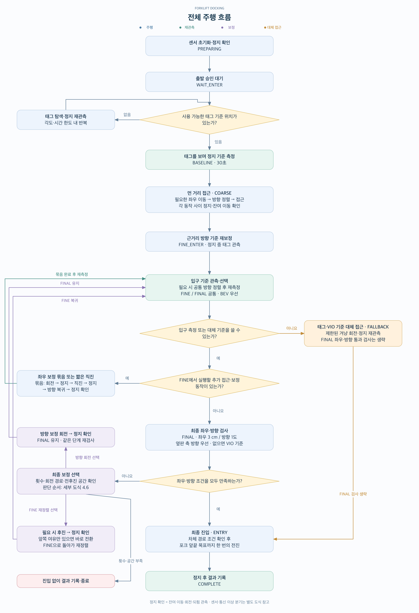
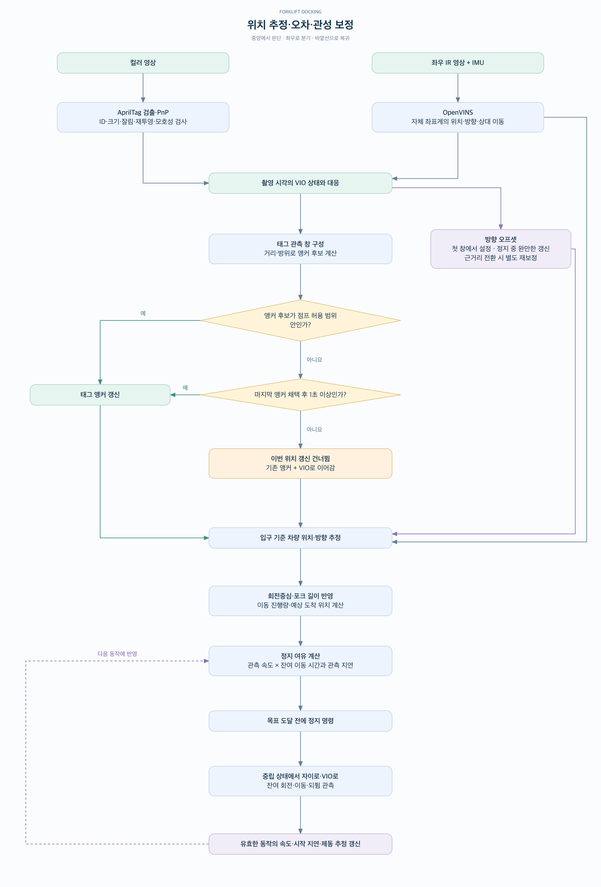
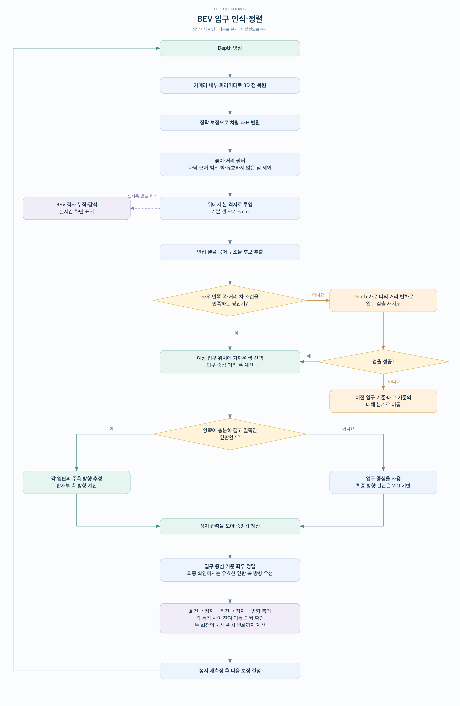
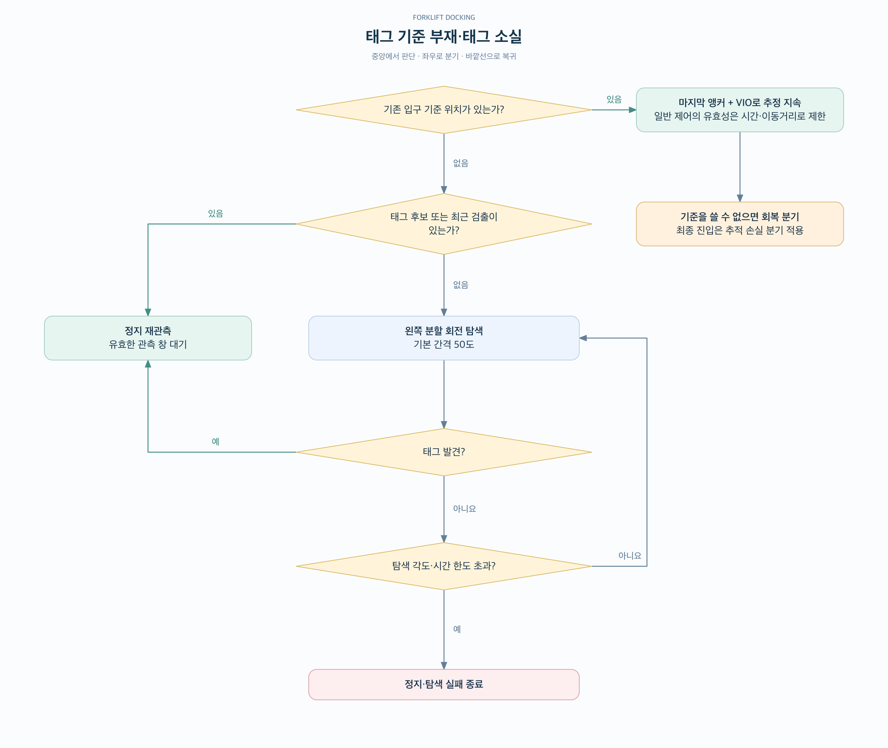
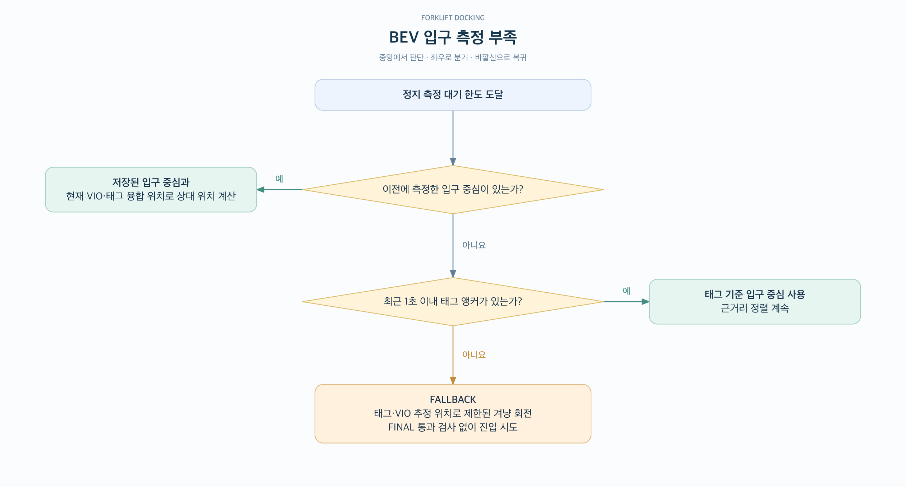
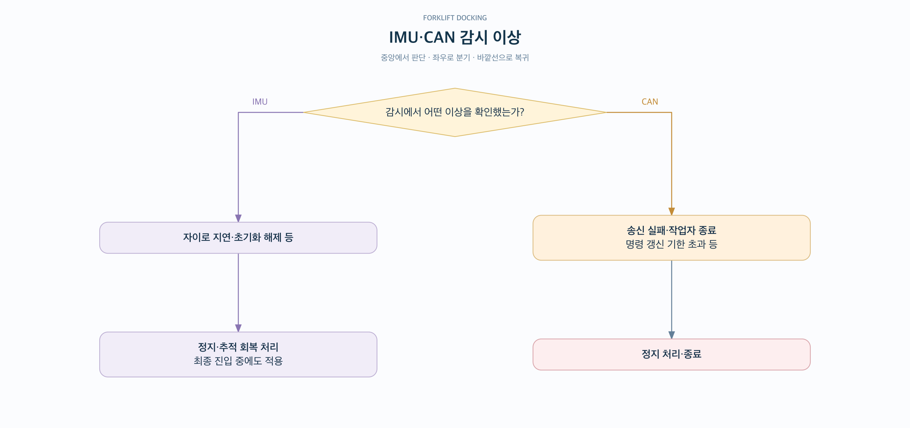
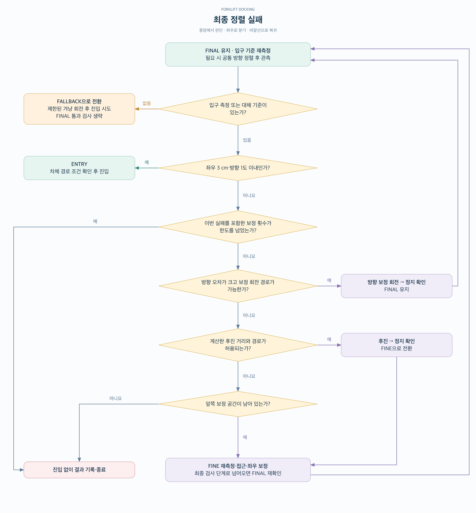

# Forklift Docking · Bird’s-eye View

AprilTag로 탑재부의 기준 위치를 잡고, OpenVINS로 차량의 이동·회전을 추적하며, Depth에서 만든 **Bird’s-eye view(BEV, 위에서 내려다본 표현)**로 입구 중심과 방향을 측정하는 지게차 도킹 시스템이다. 먼 거리에서는 태그 기준으로 접근하고, 가까워지면 입구 구조를 이용해 정렬한 뒤 포크 앞끝의 목표 위치까지 진입한다.

주행은 **먼 거리 접근 → 근거리 정렬 → 최종 확인 → 진입**으로 진행된다. 각 단계에서 관측한 위치·방향과 차량의 회전중심을 바탕으로 다음 회전 각도와 이동 거리를 계산한다.

- **컬러 영상:** AprilTag 검출, 태그의 거리·방위와 방향 기준 관측.
- **좌우 IR 영상 + IMU:** OpenVINS의 이동량·회전량 추적. 태그가 가려진 구간의 위치 추정을 이어간다.
- **Depth:** 입구 양쪽 구조물의 위치·폭 측정. 긴 옆판이 확인되면 탑재부 축 방향도 추정한다.

좌표는 입구를 향하는 방향이 전방, 차량 왼쪽이 좌측 양수다. 중앙 태그와 측면 태그 모두 설정된 태그 위치를 통해 입구 기준으로 환산한다. 정지 목표는 카메라가 아닌 **포크 앞끝**을 기준으로 하며, 입구면 기준 목표 거리는 설정을 따른다.

## 1. 전체 주행 흐름

준비 단계의 정지 확인과, 출발 승인 후 태그를 보며 수행하는 기준 측정은 별도 단계다. 보정 묶음은 **회전 → 정지 확인 → 직진 → 정지 확인 → 방향 복귀 → 정지 확인** 순서다. 정지 확인에는 잔여 이동·되튐 관측이 포함된다. 묶음이 끝나면 실제 관측 위치에서 입구를 다시 측정하고 다음 동작을 정한다.

[확대용 SVG](forklift-truck_docking_BirdsEyeView/docs/vis/01-overall-flow.svg) · [도식 원본](forklift-truck_docking_BirdsEyeView/docs/vis/01-overall-flow.mmd)

`COARSE`에서는 큰 좌우 오차를 먼저 줄이고 방향을 맞춘다. `FINE`에서는 회전중심의 위치까지 반영해 보정 각도와 직진 거리를 계산한다. 최종 확인 지점은 입구 양끝이 Depth 시야 안에 남도록 정하며, 최종 정렬 기준은 **좌우 3 cm, 방향 1°**다. 측정된 직진 쏠림 설정이 있으면 목표 방향에 반영한다.

도식의 입구 관측·선택은 `FINE`과 `FINAL`이 함께 사용한다. **방향 보정 회전 후에는 `FINAL`을 유지**하고, **후진하거나 앞쪽 보정 공간을 다시 쓰는 경우에는 `FINE`으로 돌아간다.** `FINE`에서 실행할 접근 동작이 없으면 `FINAL` 검사로 넘어간다.

위 도식은 주 접근 흐름이다. 이미 목표 거리에 도달했거나 목표를 지나친 경우는 별도로 처리한다. 목표 초과 시 공간이 허용하면 한 번 후진하고, 후진하지 못하면 결과를 기록하고 끝낸다. `COMPLETE`에는 **보정 실패로 진입하지 않고 종료한 경우도 포함**되므로 성공 판정과 구분해야 한다.

## 2. 위치 추정·오차·관성 보정

OpenVINS 내부의 시각·관성 추정과, 그 결과를 태그 기준 위치에 연결하는 외부 규칙을 구분한다. 외부 융합에서는 태그의 거리·방위로 위치 기준인 **앵커**를 갱신하고, 방향은 **VIO 방향 + 보정 오프셋**으로 계산한다. 태그가 보일 때도 이동 중 관측을 계속 사용한다.

[확대용 SVG](forklift-truck_docking_BirdsEyeView/docs/vis/02-pose-error-correction.svg) · [도식 원본](forklift-truck_docking_BirdsEyeView/docs/vis/02-pose-error-correction.mmd)

태그 창은 최대 0.5초의 관측 중 3장 이상을 사용한다. 위치 점프 허용치는 `max(0.03 m, 태그 거리 × 0.01) + 0.29 m/s × 마지막 채택 이후 시간`이다. 이 값은 설정·명목 속도에 근거한 운영 규칙이며 물리적인 오차 보증값은 아니다. 범위를 벗어나도 마지막 채택 후 1초가 지나면 후보를 채택하는 분기가 있다. **서로 다른 여러 창이 같은 위치를 계속 가리키는지 별도로 검증하는 규칙은 아니다.**

이동 중에는 태그 PnP 방향으로 오프셋을 매 프레임 바꾸지 않는다. 조건에 맞는 이동 구간이 끝나면 태그 관측과 VIO 궤적으로 장착 yaw 보정도 갱신한다. 이동 진행량은 관측을 사용하며, 전후진에서는 VIO와 태그 융합 위치의 진행량 중 더 큰 쪽으로 조기 정지를 판단한다. 제동 추정은 위치 측정값을 덮어쓰지 않는다.

정지 판단은 중립 명령, 바이어스를 뺀 자이로의 회전 크기, VIO 이동 속도를 함께 본다. VIO 속도를 계산하지 못할 때는 중립 이후 경과 시간을 대체 기준으로 사용한다. 최종 진입 중 VIO를 잃었을 때의 **시간 기반 이동 예외**는 아래 분기도에 따로 표시했다.

## 3. BEV 입구 인식·정렬

BEV는 Depth에서 복원한 3D 점을 차량 좌표계로 옮기고, 입구 양쪽 구조물의 안쪽 간격을 찾아 제어 입력으로 사용한다. 설정한 탑재부 폭과 태그 기준의 예상 입구 위치가 후보 선택에 쓰인다.

[확대용 SVG](forklift-truck_docking_BirdsEyeView/docs/vis/03-bev-entrance.svg) · [도식 원본](forklift-truck_docking_BirdsEyeView/docs/vis/03-bev-entrance.mmd)

정지 측정은 기본적으로 **0.6초 이상·4프레임 이상**을 모은다. 제어에 사용하는 입구 측정 거리는 최대 4.5 m다. 옆판 축 방향은 정지 창에서 충분히 확인된 경우 최종 방향 판단에 사용하며, 입구 양끝만 보이는 경우와 구분한다. 보정 직진 중에도 새 Depth 측정이 들어오면, 방향 복귀 후의 예상 좌우 오차를 계산해 직진을 일찍 끝낼 수 있다.

화면용 누적 BEV와 제어용 입구 측정은 별개다. 격자의 5 cm 크기는 최종 정확도를 의미하지 않으며 입구 모서리 위치는 원래 3D 점에서도 계산한다. 전방 통로의 점유 셀 개수는 **기록용**이다. 설정된 탑재부 경계에 대한 차체 경로 검사는 있지만, 이 점유 셀을 이용한 장애물 자동 정지는 구현되어 있지 않다.

## 4. 관측 실패·정렬 실패 시 분기

각 상황의 판단과 후속 동작을 독립된 도식으로 정리했다.

### 4.1. 태그 기준이 없거나 태그가 사라졌을 때

태그 기준 위치를 아직 확보하지 못했으면 탐색하거나 정지 상태로 재관측한다. 기준 위치가 있으면 마지막 앵커에 VIO 이동량을 더해 위치 추정을 이어간다.

[확대용 SVG](forklift-truck_docking_BirdsEyeView/docs/vis/04a-tag-loss.svg) · [도식 원본](forklift-truck_docking_BirdsEyeView/docs/vis/04a-tag-loss.mmd)

### 4.2. BEV에서 입구 측정이 충분하지 않을 때

BEV와 Depth 가로 띠 분석으로 충분한 관측을 모으지 못하면, 저장된 입구 중심 → 최근 태그 앵커 → 대체 접근 순으로 기준을 선택한다.

[확대용 SVG](forklift-truck_docking_BirdsEyeView/docs/vis/04b-bev-missing.svg) · [도식 원본](forklift-truck_docking_BirdsEyeView/docs/vis/04b-bev-missing.mmd)

### 4.3. 이동 중 추적을 잃었을 때

탐색 회전, 일반 이동, 최종 진입에 서로 다른 처리를 적용한다. 최종 진입의 시간 기준 전환 중에도 별도 IMU·CAN 감시는 계속된다.

[확대용 SVG](forklift-truck_docking_BirdsEyeView/docs/vis/04c-tracking-loss.svg) · [도식 원본](forklift-truck_docking_BirdsEyeView/docs/vis/04c-tracking-loss.mmd)

### 4.4. 명령을 보냈지만 이동이 진행되지 않을 때

진행량이 늘지 않는 상태가 지속되면 정체로 판단한다. 일반 이동에서는 정지 후 재판단하고, 최종 진입에서는 예정된 이동 시간으로 종료를 판단한다.

[확대용 SVG](forklift-truck_docking_BirdsEyeView/docs/vis/04d-no-progress.svg) · [도식 원본](forklift-truck_docking_BirdsEyeView/docs/vis/04d-no-progress.mmd)

### 4.5. IMU·CAN 감시에서 이상을 확인했을 때

센서·통신 감시는 주행 단계와 별도로 적용된다. IMU 이상은 정지·회복 처리로, CAN 송신 경로 이상은 정지·종료로 이어진다.

[확대용 SVG](forklift-truck_docking_BirdsEyeView/docs/vis/04e-imu-can-fault.svg) · [도식 원본](forklift-truck_docking_BirdsEyeView/docs/vis/04e-imu-can-fault.mmd)

### 4.6. 최종 좌우·방향 정렬에 실패했을 때

좌우·방향 조건을 함께 확인한다. 실패하면 보정 횟수 한도를 먼저 확인한 뒤 **방향 보정 회전 → 후진 가능 여부 → 앞쪽 보정 공간** 순으로 다음 동작을 선택한다. 회전만 하면 `FINAL`을 유지하고, 후진 또는 앞쪽 공간을 이용한 재정렬은 `FINE`으로 돌아간다. 보정할 수 없으면 진입하지 않고 결과를 기록한다. `FINAL` 재측정에서도 입구 기준을 확보하지 못하면 `FALLBACK`으로 전환한다.

[확대용 SVG](forklift-truck_docking_BirdsEyeView/docs/vis/04f-final-alignment.svg) · [도식 원본](forklift-truck_docking_BirdsEyeView/docs/vis/04f-final-alignment.mmd)

대체 진입 `FALLBACK`은 정상 `FINAL`의 좌우·방향 동시 통과 절차와 다르다. 제한된 겨냥 회전 후 진입하며, 예상 도착 좌우 판정은 기록하지만 **그 판정이 거짓이라는 이유만으로 진입을 막지는 않는다.** 최종 진입의 시간 기준 전환도 관측 정확도가 회복됐다는 뜻은 아니다.

주요 시간 제한은 출발 전 준비 180초, 출발 승인 후 전체 주행 600초, 태그 탐색 180초·최대 한 바퀴, 정지 재관측 20초, 추적 회복 60초다. 정지 재관측에서 회복으로 넘어간 경우 회복 시간은 원래 정지 시각부터 계산한다. 근거리 방향 재보정은 8초 안에 되지 않아도 기존 기준으로 다음 단계에 진행한다. 개별 이동·회전 한도는 설정값과 예상 동작 시간으로 산정하며, 진행 정체는 기본 2초, 일반 이동의 정체 중단이 3회를 넘으면 종료한다.

정지 기준 측정·관측 창 흔들림·VIO 누적 분산으로 계산하는 `σ`는 **기록용**이며 최종 진입 조건은 아니다. 도식의 허용치와 종료 상태는 코드의 판단 규칙을 뜻하고, 실제 포크 끝 정확도나 충돌 방지를 보증하지 않는다.

**구현 위치:** 전체 흐름·예외 처리는 `docking/controller.py`, 센서 연결은 `docking/camera.py`와 `docking/runtime.py`, 위치 추정은 `docking/observer.py`·`docking/fusion.py`, BEV 입구 검출은 `docking/bev.py`·`docking/depth_goal.py`, 보정 기하는 `docking/fine.py`, 정지 판단은 `docking/stationary.py`에 있다. 허용치와 시간 제한은 설정에 따라 달라질 수 있다.
