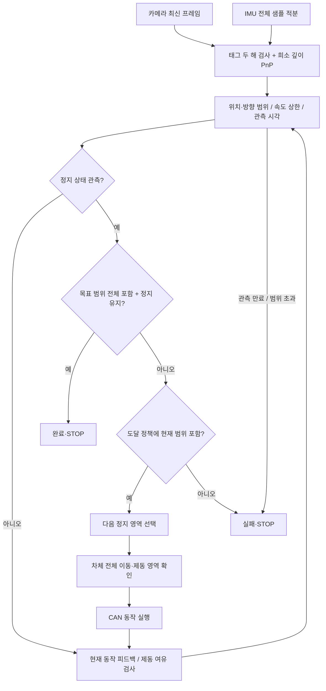
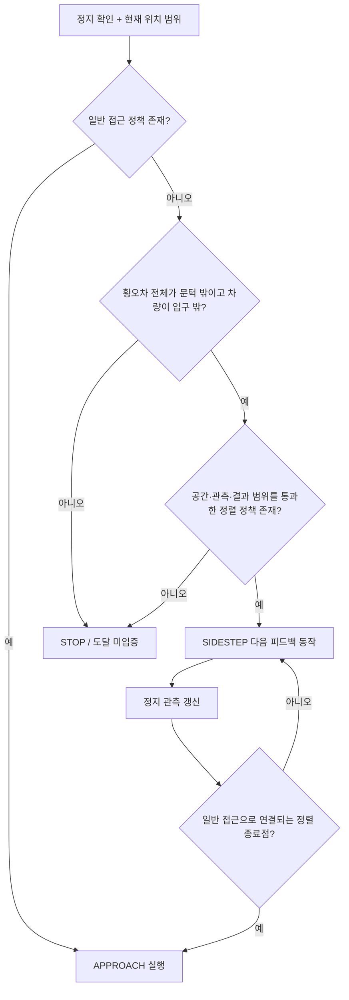
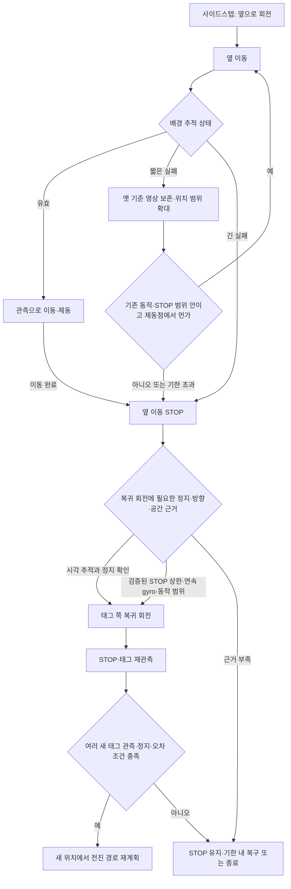

# 방법론과 코드의 대응

이 구현은 기존 논문의 아이디어를 조합한 연구용 제어기다. 논문 구현을 그대로 이식했거나, 논문의 실험 정확도가 이 차량에 그대로 성립한다고 주장하지 않는다.

## 전체 흐름



## R0: 무엇을 목표로 하는가

상태는 탑재부 좌표계의 `x, y, yaw`다. `x`는 진입 방향, `y`는 왼쪽, yaw는 반시계 양수이며 **모든 각도는 rad**다. 제어점은 설정한 차량 기준점이고 몸체는 그 점에서 앞/뒤/좌우로 뻗은 사각형이다. 회전 시 그 사각형 전체를 검사한다.

실장비 기본 기준점은 카메라와 같은 앞뒤 위치의 차체 중심선·바닥 높이 점이다. 순간 회전중심이 아니며, 회전중심 이동은 별도 동작 오차로 다룬다. 세 실측 치수와 변환 구성은 `CONFIGURATION.md`에 설명했다.

사용자는 차량 전체가 들어온 상태에 해당하는 기준점 목표 범위를 설정해야 한다. `goal`은 포크 끝 목표가 아니다. 목표 영역에 차체가 들어갈 수 없는 설정은 정책 합성에서 이기는 상태가 생성되지 않는다.

### 측면 태그와 사전 정렬: 조건부 사이드스텝 합의

2026-10-11 사용자는 태그를 입구 좌/우에 설치하고, 콘 구간에 진입 후 더 전진하여 정지하는 시험을 설명했다. 따라서 목표선은 태그 자체의 법선 위가 아니라 **통로 중심을 지나는 진입선**이다. 태그가 입구 면과 평행하면 태그의 진입 방향을 알고 있는 횡방향 오프셋만큼 옮겨 사용한다. 평행하지 않으면 부착 방향 보정도 필요하다.

2026-10-11 사용자 합의: **통로 중심선에서 옆으로 크게 벗어나 일반 접근으로 진입 정렬이 어려울 때만 사이드스텝을 적용한다.** 입구 밖에서 회전·전진·반대 회전으로 횡위치를 보정한다. 중심선에 충분히 가까우면 사이드스텝을 생략하고, 방향만 어긋났다면 방향 보정 후 회전으로 변한 위치도 다시 확인한다. 관측 불량이나 다른 이유로 일반 접근이 실패했다는 사실만으로 사이드스텝을 선택하지 않는다.

“크게 벗어남”의 수치 기준은 아직 확정하지 않았다. 통로 폭·차체 폭·접근 거리·위치/방향 오차 범위와 실행 가능한 접근 동작을 함께 검토해 정해야 하며, 근거 없이 고정 cm 문턱을 넣지 않는다. 목표선은 측면 태그의 위치 자체가 아니라 오프셋을 반영한 통로 중심선이다. 항상 90도 회전하거나 현재 횡오차의 절반을 시간으로 이동하는 규칙을 그대로 되살리는 것은 아니다. 사이드스텝도 경로 전체의 차체 여유, 제동 여유, 태그 또는 배경 추적 가능성을 확인한 경우에만 실행하도록 설계한다.

현재 `mission.py`는 두 정책을 합성한다. 먼저 최종 목표까지의 `APPROACH`를 계산하고, 그 정책의 도달 가능 상태 중 사전 정렬 목표에도 포함되는 상태를 `SIDESTEP`의 종료점으로 삼는다. 따라서 정렬만 성공하고 다음 접근이 없는 연결은 사용하지 않는다. 큰 회전 후보에 `sidestep_only=true`를 붙이면 일반 접근에서는 사용하지 않는다. 이 플래그가 없는 회전은 두 단계 모두 사용할 수 있다.

처음 정지 관측에서 일반 접근 정책을 먼저 조회한다. 없을 때만 횡오차 구간 **전체**가 문턱 밖이고 차량 전체가 입구 밖인지 검사한다. 기본 문턱 계산은 `통로 반폭 - 차체 반폭 - 공간 여유`이며, 현장에 맞춘 명시적 `trigger_lateral_m`도 지원한다. 문턱을 넘었다고 무조건 움직이지 않는다. 해당 관측 구간에서 사이드스텝 정책이 존재하고 설정된 동작 횟수 안에 정렬 가능한지도 필요하다. 횡오차가 작고 방향만 큰 경우는 사이드스텝으로 우회하지 않는다.

사이드스텝은 목표선에 대한 위치/방향 허용 범위로 정렬하며 **모든 중간 이동·제동 범위에서 차체 전체가 입구 밖**이어야 한다. 매 정지 후 다시 관측해 다음 회전/전진/후진 후보를 선택한다. 정렬 종료점에서는 일반 접근 정책으로 한 번 전환하고 되돌아가지 않는다. 정렬 중 정지 단계는 엄격히 감소하며 단계 전환 시 일반 접근의 순위를 새로 적용한다. 큰 회전·작은 회전의 실제 각도 후보와 오차 범위는 장비 검증값이 필요하다.



`visibility.py`는 태그 앞면, 전체 모서리의 화면 여유, 최소 투영 크기를 구간 연산으로 검사한다. 왜곡/장착 오차의 픽셀 여유는 별도 검증값이다. 태그가 시야 밖인 구간은 현장에서 관측 가능성을 확인한 `odometry_regions`와 근거가 있어야 통과한다. 이는 특정 영역에 무늬가 언제나 보인다는 자동 증명이 아니다. 가림·햇빛·새 장애물·반복 무늬는 실행 중 추적 검사와 운용 조건으로 다뤄야 한다. 해당 구역이 없으면 장거리 태그 소실을 포함하는 경로는 합성되지 않을 수 있다.

## R1: 오차는 흔들림 통계와 다르다

태그는 IPPE 두 자세 후보를 비교하고, 가장자리 잘림/최소 모서리 픽셀 길이/재투영 오차/모호율/동일 ID 중복을 검사한다. ROI 검출 후 모서리를 원래 영상 좌표로 복원한다. 평균을 오래 낸 결과의 작은 표준편차를 정확도 상한으로 쓰지 않는다.

태그가 보이는 동안 이미 일반 특징점을 추적한다. 이전 깊이로 특징점을 3차원으로 만들고 KLT로 다음 영상까지 추적한 뒤 RANSAC PnP로 상대 카메라 변환을 얻는다. 역방향 KLT 검사, 깊이 불연속 검사, 특징점의 영상 내 분포, inlier 비율과 이동량 상한을 함께 검사한다. 특징점 수를 제한하며 전체 지도나 장기 keyframe 최적화는 저장하지 않는다.

태그 절대 기준에 상대 변환을 누적하고, IMU의 영상 촬영 시각 사이 상대 yaw를 사용한다. 태그와 영상 추정의 범위가 충돌하면 새 절대 기준을 거부한다. 짧은 실패에는 옛 기준 영상을 보존한다. 새 좌표로 재추적하면 검증된 속도 상한×소실 시간의 위치 오차를 추가한 거친 범위를 연결할 수 있다. 이는 정밀 절대 위치 복구가 아니며, 사이드스텝 복귀 후 새 태그 기준을 확보해야 다시 전진한다. 자세한 복귀 조건은 README와 CONFIGURATION의 리뷰 4·5·6·7 보완 절을 따른다.

오차 범위는 설정된 태그 오차 + 이동 거리·회전량·프레임 구간 수에 비례하는 상대 추적 오차 + 방향 오차가 거리/카메라 레버암에 미치는 영향을 누적한다. 프레임 구간 수는 `max(처리 수, 경과시간×설정 FPS)`로 계산하여 처리 누락이 오차 예산을 줄이지 않게 한다. 이는 **설정한 상한이 실제를 덮는다는 조건의 구간 추정**이다. RANSAC residual이나 특징점 개수만으로 그 상한을 증명하지 않는다. 장면 전체가 움직이거나 반복 무늬를 일관되게 잘못 대응하는 경우를 일반적으로 해결하지 못한다.

2026-10-15: 실제 프로필에서 태그 보정 비중을 제한하고 현재 시각 VO·gyro 예측과 결합한다. 원시 태그 위치와 보정된 중심 사이 차이를 태그 오차에 더해 원시 오차 구간 전체를 보존한다. 태그/VO의 독립성을 가정하거나 반복 관측으로 오차가 0으로 수렴한다고 처리하지 않는다. 기존 국소 추적 좌표는 태그 보정만으로 초기화하지 않는다. 완전한 VIO/EKF와 구분하며, [연구 근거 및 적용 범위](ODOMETRY_METHODS.md)에 수식과 한계를 정리했다.

카메라와 IMU의 하드웨어 시각으로 상대 시간 간격을 계산한다. 현재 시각으로의 age 상한은 별도로 검증된 `capture_to_callback_max_s`와 host 도착 이후 경과를 사용한다. 단순 최소 host-device offset을 실제 전달 지연이라고 간주하지 않는다. 미측정이면 age 상한은 비어 있고 주행 자격이 없다.

## R2/R3: 다음 정지 영역과 실제 동작 계약

각 후보는 일정 시간 명령을 내는 open-loop 명령이 아니라 **특정 정지 좌표/방향을 향한 피드백 동작**이다. 격자 셀 중심에서 전진 거리 또는 회전량을 더한 목표를 잡는다. 매 정지 뒤 새 관측 셀에서 다시 선택하므로 다음 목표점은 바뀐다.

- 직진: 현재 셀 중심 yaw 방향의 진행 좌표가 목표값에 도달하도록 한다. 옆으로 밀리는 양에는 시작 방향 구간, 주행 중 yaw 변화, 미끄러짐 범위가 들어간다. 주행 중 회전을 동시에 명령하지 않는다.
- 회전: 절대 yaw 목표를 정하고 IMU 상대 yaw를 태그 기준에 연결해서 접근한다. 실제 회전중심 이동과 잔여 회전은 동작 오차에 포함해야 한다.
- 목표보다 `brake_reserve`만큼 먼저 STOP한다. 이 값은 현재 프로파일 속도 범위에서 샘플 간격·영상 age·명령 지연·관성/되튐까지 포함해야 한다. 물리적으로 이보다 정지 범위가 넓으면 계약 자체를 바꿔야 한다.
- `min_target`보다 작은 동작은 사용하지 않는다. 시작 구간 폭을 빼도 최소 이동량이 확보되는지 합성 시 검사한다.

`terminal_error`는 해당 피드백 정책이 **정지 확인 후** 도달할 수 있는 오차 범위다. 직진은 진행/횡방향/heading, 회전은 dock x/dock y/heading 순서다. `sweep_error`는 동작 도중과 STOP 이후 잔류 운동까지 포함하는 더 큰 범위다. 명령 전 잔류 속도, 명령 중 중단에 따른 정지, 지연 변동, 회전중심 변동을 포함해야 한다.

차체의 네 모서리에 대해 모든 heading 범위의 sin/cos 극값을 사용해 보수적 AABB를 계산한다. 경로를 분할하되 **분할 경계 점만 찍는 것이 아니라 각 구간 전체의 포락선**을 검사한다. 여러 자유 직사각형의 합집합에 걸친 공간은 일부 보수적으로 거부할 수 있다. 장애물이 있는 빈틈을 자유공간으로 메우지는 않는다.

## R4: 명목 경로 탐색과 다른 부분

관측값 `z`를 포함하는 격자 구간을 `C(z)`, 검증된 관측 오차 상한을 `E`라 하면 노드가 나타내는 실제 상태 범위는 다음과 같다.

`B(z) = C(z) ⊕ [-E, E]`

동작 `a`의 최종 도달 범위를 `F(B,a)`라고 하면 다음 관측값은 `F(B,a) ⊕ [-E,E]` 안에 있다. 코드에서는 이 범위에 걸친 **모든 다음 관측 셀**을 나열한다. 다음 셀도 다시 그 셀 폭에 `E`를 더한 belief를 의미한다.

```text
W0 = 차체가 안전하며 B 전체가 목표 안에 있는 노드
Wk+1 = Wk ∪ { B : 어떤 실행 가능한 a가 있고,
                   모든 동작/제동 구간이 안전하고,
                   모든 가능한 다음 관측 노드가 Wk에 포함됨 }
```

AND는 동작 하나에서 생길 수 있는 모든 결과, OR는 선택 가능한 여러 동작이다. 모든 결과를 만족하는 동작이 없다면 노드를 넣지 않는다. 이미 들어온 단계보다 낮은 단계로만 가므로 같은 위치에 계속 머무는 self-loop는 목표 도달 증거가 되지 않는다.

실행 시 가장 가까운 셀의 중심만 검사하지 않는다. 관측값으로 정해진 셀의 belief가 현재 범위 전체를 포함해야 한다. 정책 파일은 설정 hash와 알고리즘 버전을 저장하고, 로드할 때 각 노드의 차체 안전성·목표 포함·모든 후속 단계 감소를 다시 검사한다.

**적용 한계:** 유한 도메인, 고정된 관측 오차 예산, 유효한 동작 계약, 지정 시간 안의 정지/재관측이라는 가정이 있다. 관측 상한이 커지거나 3 cm 통로가 너무 좁으면 시작 상태가 `W`에 없을 수 있다. 그 경우의 결론은 “더 큰 임의 보정값으로 실행”이 아니라 “이 센서/동작 조건에서는 도달이 입증되지 않음”이다. 이 구현은 시변 belief 크기 전체를 상태축으로 갖는 일반 POMDP solver가 아니다.

## R5~R7: 주행·정지·완료

시작 영점 보정은 `calibration.py`에서 gyro와 accel의 서로 다른 실제 시각 샘플로 수행한다. 기본 10초 창, 최소 기대 샘플 비율 0.5, gyro 0.5°/s 움직임 검사와 분산 검사, gap/clock 검사로 움직인 구간을 제외한다. 중력으로 yaw 투영축 기울기를 맞추되 회전 부호는 별도 실물 확인이 필요하다. 등속 직선 이동은 이 센서의 정지 보정 검사만으로 배제할 수 없으므로 사용자가 정지 상태를 유지해야 한다. 측정 프로필의 분산/기울기 문턱은 시작용 값이며 센서 오차 상한 인증값이 아니다.

시간 제한은 영상 도착 여부와 무관하게 host 단조 시계로 검사한다. `max_start_delay_s`는 명령부터 **오차 범위를 넘어선 이동이 처음 관측될 때까지**의 상한이고, 그때부터 `max_duration_s`를 센다. 최초 관측 지연까지 포함하므로 기계의 순수 출발 지연과 동일한 측정값은 아니다. STOP 후 허용 시간은 동작별 `max_stop_response_s`와 정지 확인용 `limits.settle_timeout_s`를 합한다. 이 시간은 기다릴 수 있는 최대치이며, 충분한 새 관측으로 정지 유지가 확인되면 일찍 다음 판단으로 넘어간다.

출발이 늦다는 이유로 오래된 관측이나 끊어진 제어 명령을 유효하게 만들지는 않는다. `limits.max_age_s`, `imu.max_age_s`, CAN `lease_s`는 각각 관측 신선도와 제어 프로세스 갱신에 대한 별도 항목이다. 실차에서는 이 값들과 출발/제동 범위를 해당 Nano 또는 VM에서 확인해야 한다. 8초/15초 같은 이전 시간 제한은 참고 기록으로만 남겼다.

주행 중에도 계속 관측한다. 회전 시작 전과 회전 종료 후에는 실제 정지 확인이 필요하지만, 측정을 위해 매 프레임 멈추는 방식은 아니다.

복구 기능이 켜져 있으면 오래된 관측·일시적인 IMU/특징점 문제·관측 예산 초과·정책 밖 관측은 STOP 후 제한된 재측정으로 이어진다. 역행한 timestamp, 공간/운동 계약 위반, 복구 한도 초과는 FAULT로 남는다. 사용자 정지와 CAN watchdog 잠금은 복구 로직이 해제하지 않는다. IMU의 가속도 적분만으로 남은 수 m를 계속 주행하는 fallback은 없다.

정지 확인은 연속 두 영상의 차량 기준점 이동량에 상대 측정 오차를 더한 속도 상한과, 구간 내 가속도 상한을 사용한다. IMU 각속도도 상한으로 검사한다. 같은 영상의 복사본을 여러 번 받아도 정지 유지 시간을 채울 수 없다. STOP 명령 자체를 속도 0의 측정으로 사용하지 않는다.

최종 성공은 위치/방향 범위 전체의 목표 포함, 속도/각속도 상한, 정지 유지 시간이 모두 충족된 경우다. 태그가 사라진 시점이나 예약 주행 시간이 끝난 시점으로 성공을 선언하지 않는다.

## 근거와 구현의 차이

- [Liu & Ozay, 2016, Finite abstractions with robustness margins](https://www.math.uwaterloo.ca/~j49liu/papers/2016/liu2016finite.pdf): bounded 측정/지연/모델 오차를 추상화 여유로 다루는 근거. 여기서는 전체 비선형 지게차 ODE를 검증한 것이 아니라 검증되어야 할 정지 동작 범위를 입력받는다.
- [SCOTS](https://www.hyconsys.com/software/scots/): 유한 추상화에서 안전/도달 제어기를 합성하는 방향의 근거. 이 코드는 SCOTS를 호출하지 않고 작은 관측 belief 게임을 직접 구현한다.
- [Majumdar & Tedrake, Funnel Libraries, 2017](https://arxiv.org/abs/1601.04037): 피드백 동작의 전체 이동 범위를 연결하는 생각의 근거. 이 차량의 SOS funnel 증명을 수행한 것은 아니다.
- [OpenCV PnP 공식 설명](https://docs.opencv.org/4.x/d5/d1f/calib3d_solvePnP.html): IPPE square 점 순서, 다중해, RANSAC PnP API 근거. 재투영 오차가 작다는 사실과 차량 위치 오차가 작다는 사실을 구분한다.
- [AprilTag 공식 튜닝 안내](https://github.com/AprilRobotics/apriltag#tuning-the-detector-parameters): decimation/threads 조절 근거. 속도를 위해 줄인 영상이 인식 거리/정확도에 영향을 주므로 현장 비교가 필요하다.
- [RealSense 영상 정렬 예제](https://github.com/realsenseai/librealsense/blob/master/examples/align-advanced/rs-align-advanced.cpp): 깊이와 다른 영상 스트림을 같은 좌표에 맞춘 후 특징점 깊이를 읽는다.
- [VINS-Mono](https://arxiv.org/abs/1708.03852), [OpenVINS 설정](https://docs.openvins.com/structov__msckf_1_1VioManagerOptions.html): 비학습 기반 영상·IMU와 제한된 특징점/처리율 접근의 참고. 이번의 희소 깊이 PnP+gyro 검사기는 이들의 MSCKF/최적화 구현과 동등하지 않다.

## 코드 출처

장비 명령의 CAN ID/바이트/주기는 `apriltag_v5/src/models/kwu/control.py`와 `src/models/control/frames.py`를 확인해 별도 구현했다. 두 원본을 수정하거나 vendor 파일을 복사한 것은 아니다. v3 `tools/dock.py`, `tools/check/live_pose.py`와 v5 `src/utils/hud.py`에서 기존 화면에 필요한 항목을 확인했고, 원격 화면은 읽기 전용 HTTP/MJPEG로 새로 만들었다.

## 제한된 관측 복구 (2026-10-11 추가)

### 일반 주행 이전의 최초 획득

`StartupSearch`는 Enter 이후, 최초 한 번만 수행한다. 자이로 시작 보정과 실제 정지 확인 후 태그 부재가 여러 검출 시도에서 이어지면 제자리 회전한다. 회전 중 목표 ID를 검출하면 즉시 STOP을 요청하며, 실제 정지 뒤 새 태그 자세를 여러 번 수락하고 안정 시간·오차 조건을 만족해야 정책에 진입한다. 발견한 한 프레임의 PnP가 불확실해도 정지는 하되 그 값으로 출발하지 않는다.

태그 획득 전에는 탑재부 좌표계의 위치/자유공간 판정을 할 수 없다. 대신 실제 초기 기준점 주변의 별도로 확인한 자유 원이 차체 전체 회전과 기준점 병진 편차·제동 여유를 포함해야 한다. 절대 태그 위치 없이도 연속 영상 상대 운동과 보정된 gyro로 초기 대비 회전/병진을 감시한다. 추적이 끊기거나 예산을 넘으면 종료하고 무관측 회전은 계속하지 않는다. 이 절차 자체는 목표 도달 정책의 rank 증명에 포함하지 않는다.

초기화 완료는 영구 latch로 유지한다. 이후 태그 잘림/사이드스텝은 아래 복구 처리만 사용한다. 제동 중 태그를 다시 놓쳐도 초기 탐색을 무한 반복하지 않는다. 탐색의 각도/시간 예산과 별개로 전역 실행 시간은 계속 흐른다.

### 주행 중 복구

`PAUSING`은 계속 STOP을 보내며 정지 관측을 기다리고, `REOBSERVING`은 실제 정지 뒤 신선한 관측을 수집한다. 관측 반경이 고정 예산의 pause 비율을 넘으면 제동하며, resume 비율 아래로 충분히 회복된 새 관측이 정해진 시간·개수 동안 일관되어야 재계획한다. 일관성 검사용 구간 교집합을 실제 오차 축소에 사용하지 않는다. 센서 연결을 잃은 경우에는 재검출 태그의 서로 다른 관측도 요구한다. 정지 중이라는 이유만으로 태그나 odometry 오차를 0으로 만들지 않는다.

중간 정지 시 기존 동작의 최종 도착 계약은 버리되, STOP을 포함한 전체 이동 포락선은 보존하여 재관측과 모순되는지 확인한다. 새 관측에서 정책을 다시 조회한다. 원래 rank 감소는 완수한 정상 동작 사이의 속성이다. 복구로 중단한 동작에는 이를 주장하지 않으며 복구 횟수, 전역 시간/동작 수, 정렬 단계 예산으로 반복을 제한한다. 복구가 항상 성공하거나 임의 위치에서 목표 도달을 보장한다는 뜻은 아니다.

SIDESTEP 시작 yaw를 저장한다. 태그만 사라진 경우 연속 odometry·IMU·기존 절대 기준이 유효해야 그 방향으로 돌아보는 회전을 허용한다. `return_rotation`은 기존 회전 후보 중 방향 오차의 최악 범위를 줄이고, STOP까지 포함한 차량 영역/관측 가능 영역 검사를 통과하는 동작만 선택한다. CAN 강도나 회전 목표 각도를 즉석에서 바꾸지 않는다. 추적을 잃고 새 상대 좌표를 만든 경우에는 이 회전을 허용하지 않는다.

정지 중 바이어스 재보정은 독립된 시각 정지 증거와 신선한 중립 명령이 있는 구간의 gyro/accel 샘플로 수행한다. 영상 이전 시각까지의 IMU만 쓰며 같은 영상의 복제본, 영상 gap, 움직이는 구간은 보정을 진행시키지 않는다. 누적 적분값/기존 history/절대 방향 오차는 보존하고 이후 적분에 쓸 바이어스만 바꾼다. 시작 바이어스와의 총 차이가 검증 범위를 넘으면 적용하지 않는다. `gyro_rate_error_rps`의 검증은 재보정 후 잔여 오차와 정지 판정의 불확실성도 포함해야 한다.


## 추적 소실 시 복귀 흐름 (리뷰 4·5·6·7 반영)



복귀 시 위치 범위는 정밀 도킹 문턱보다 클 수 있다. 대신 그 위치 범위 어디에서 돌아도 차체와 포크가 공간 안에 남아야 한다. 이 범위가 너무 커 회전 가능성을 확인하지 못하면 회전하지 않는다. 복귀 회전이 끝났다는 이유로 측정 오차를 줄이거나 최종 도킹 성공을 선언하지 않는다.
