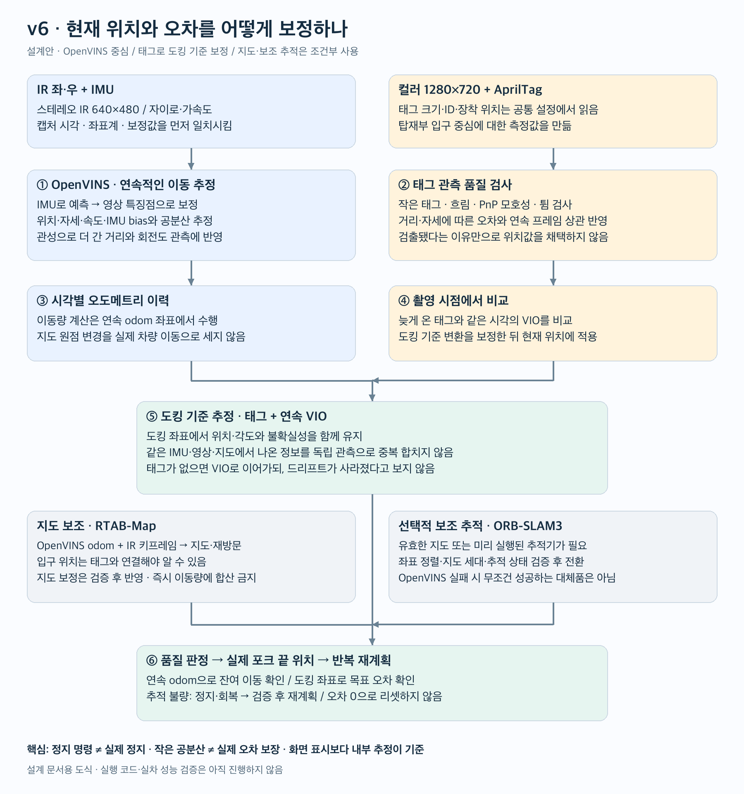
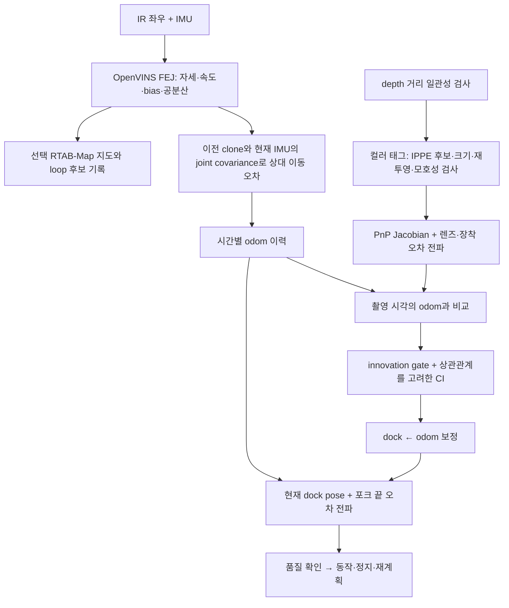
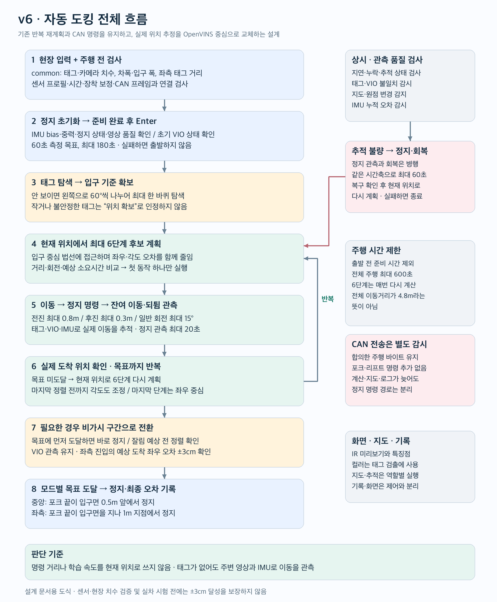

# v6 알고리즘과 구현

2026-10-16: 설계 검토 후 실행 코드 구현. Jetson 설치·네이티브 빌드·카메라·CAN 실물 검증은 아직 수행하지 않았다. [실행 순서](run.md)

## 센서와 라이브러리

| 역할 | 구현/의존성 | 현재 상태 |
|---|---|---|
| 연속 이동·각도·bias | OpenVINS MSCKF/FEJ, stereo IR + IMU | ROS 2 C++ 브리지 및 Python 런타임 연결 |
| 입구 기준 측정 | pupil-apriltags + OpenCV IPPE | 컬러 1280×720, ROI/주기 검출, PnP 품질·공분산 검사 |
| depth | librealsense 컬러 정렬 depth | 태그 거리 일관성 검사. 독립 pose 업데이트로 더하지 않음 |
| 지연·누적 오차 | 시각별 VIO 이력 + dock←odom 보정 | 촬영 시각에서 비교, 지연 관측 재처리, covariance intersection |
| 장착 보정 | 기준 정렬 태그 측정 + OpenCV | preflight mount, 공통 IR 장착 기준으로 저장 |
| 일반 hand-eye | OpenCV calibrateHandEye | 독립 3D 운동 자세 데이터용 오프라인 도구. 관측 불가능한 평면 회전 거부 |
| 렌즈 재보정 | OpenCV calibrateCameraExtended | 보류 영상 재투영 검사와 파라미터 불확실성 보고, 명시적으로 검증한 결과만 적용 |
| 지도 | RTAB-Map ROS 2, 외부 OpenVINS odometry | mapped 프로필에서 지도 DB/loop 후보 기록. 제어 pose로 자동 채택하지 않음 |
| ORB-SLAM3 | 공식 소스 준비 | 실행 adapter/자동 전환 미구현. 기본 설치 제외 |
| WPILib / robot_localization | 보관한 공식 참고 소스 | 촬영 시각 보정·innovation 검사 참고. 실행 라이브러리로 중복 융합하지 않음 |

BASALT, VINS-Fusion, cuVSLAM, 별도 GTSAM smoother, 새 MPC/Reeds-Shepp 제어기는 기본 실행에 넣지 않았다. 기존 6단계 후보 계획과 CAN 동작을 유지하면서 관측 추정을 바꾼다. CAN 바이트·transport watchdog은 v5에서 그대로 복사했다.

## 입력 처리와 시간

한 Python 프로세스만 카메라를 소유한다. 같은 RealSense의 Motion Module과 영상 센서를 각각 SDK pipeline으로 열되 다른 프로그램이 장치를 중복 열지 않는다.

- IR 좌/우 640×480, 컬러 1280×720, depth 640×480, 30Hz 요청.
- 자이로 200Hz, 가속도 100Hz 요청. 가속도를 자이로 좌표계로 회전하고 양옆 표본으로 자이로 시각에 보간한다. 누락·역행·큐 초과는 오류다.
- IR stereo는 SDK extrinsics와 실제 intrinsics로 rectification한다. OpenVINS에는 rectified pinhole과 그에 맞게 회전된 camera←IMU 변환을 전달한다. 임의 D455 예제 숫자를 복사하지 않는다.
- 프레임 hardware clock을 검사하고 dt는 device seconds로 계산한다. host monotonic은 지연/신선도 검사에만 쓴다. 장치 벽시계가 1970년이어도 적분 시간축을 대체하지 않는다.
- stereo 쌍의 실제 시각 차가 2ms를 넘으면 거부한다. 컬러 측정은 별도 촬영 시각에 맞춰 VIO 이력에서 보간한다. depth와 컬러 시간 차가 큰 경우 depth 보조 검사는 생략한다.
- 영상 큐는 최신 쌍 위주로 제한하고 IMU는 순서대로 전부 전달한다. 기존 오래된 이미지가 쌓여 뒤늦게 차량을 제어하지 않는다.

CPU 연산은 OpenVINS native worker, 컬러 태그 thread, JPEG thread, 로그 thread, 계획 process, CAN process로 분리했다. ROS reliable 전달이 느려져도 제어 supervisor와 CAN watchdog은 별도다. 이는 deadline을 감시하는 일반 Linux 구조이며 hard real-time 보장이 아니다.

## 위치와 오차 보정

그림의 지도/ORB 분기는 확장 설계를 포함한다. 아래가 현재 실행 경로다.

### 연속 이동과 절대 위치를 분리

`local_pose`는 OpenVINS의 연속 odom 좌표다. 태그가 입구 위치를 보정하는 `dock←odom` 변환은 별도로 유지한다. 명령 1m 후 실제 관측 이동이 1.2m라면 제어기의 progress는 관측 1.2m를 사용한다. 태그 보정으로 좌표가 20cm 변한 것은 물리적인 추가 이동 20cm로 기록하지 않는다.

OpenVINS 자체의 영상 업데이트는 상태를 계속 보정한다. 그 수치가 완벽한 물리 참값이라는 뜻은 아니다. frame gap/clone 연속성 소실·시각 역행·센서 epoch 변경 때는 기존 도킹 anchor와 동작 연속성을 무효화하고 정지한다. 학습한 속도·지연은 후보 시간과 제동 여유를 위한 값으로만 쓰고 pose에 적분하지 않는다.

### VIO의 원점 오차를 중복 계산하지 않음

OpenVINS의 초기 전역 원점·yaw는 임의 기준이다. 태그가 현재 입구 기준 위치를 알려주는데도 두 시점의 절대 covariance를 독립이라고 더하면 공통 원점 오차까지 두 번 센다.

C++ 브리지는 **직전 pose clone과 현재 IMU pose의 joint covariance(교차 공분산 포함)**에서 상대 SE(3) 이동의 covariance를 계산한다. JPL 회전 규약을 world left-rotation 규약으로 변환하고, camera/IMU에서 차량 기준으로 옮길 때 lever arm을 포함한다. ZUPT 경로도 다음 상대 covariance 계산을 위해 현재 pose의 correlated clone을 보존한다. 이전 clone 값이 이후 관측으로 바뀌었다면 그 변경량도 추가 오차 여유에 넣는다.

Python은 태그 anchor 이후의 상대 이동 불확실성을 전파한다. 시간적으로 독립이라고 가정하지 않고 표준편차를 누적하는 보수적 상계를 사용한다. 상대 covariance가 없는 구간을 임의로 작은 값으로 채우지 않는다. 이 구성은 1차 선형화와 센서 noise 모델을 사용하므로 실제 오차의 증명된 상한은 아니다.

### 태그 품질과 covariance

검출 ID/중복·hamming·decision margin, 최소 변 길이, 잘림, IPPE 두 해의 모호성, 재투영 오차를 검사한다. 작은 태그를 단순 검출했다는 이유로 180초 동안 탐색을 멈추는 동작은 피한다.

선택한 PnP 해 주변에서 8개 코너 좌표의 Jacobian으로 SE(3) covariance를 계산한다. corner noise는 설정한 최소값과 재투영 잔차 중 큰 값을 사용한다. 별도 렌즈 재보정 결과가 있으면 fx/fy/cx/cy와 왜곡 계수의 covariance도 전파한다. 장착각·위치 오차 및 최소 편향 여유를 추가한다.

이 계산은 **선택된 평면 해가 맞다는 조건**의 국소 근사다. 잘못된 branch, 잘못 입력한 태그 크기, 체계적인 왜곡을 필터가 자동 해결한다고 가정하지 않는다. depth는 일관된 유효 표본이 충분할 때 모순을 거부하며 독립 측정인 것처럼 두 번 합치지 않는다.

### 지연·상관·이상치

5초/300개 이력을 제한적으로 보관한다. 촬영 시각을 벗어나 외삽하거나 다른 센서 epoch를 연결하지 않는다. 지연 태그는 해당 시점의 상태에서 보정을 만들고 촬영 순서로 재처리한다.

태그 업데이트는 0.2초 시간 구간별로 제한한다. 연속 영상의 상관관계를 알 수 없으므로 일반 독립 Kalman 평균 대신 **covariance intersection**을 사용한다. 같은 covariance의 정지 태그를 100번 넣어도 1/100로 줄지 않는다. 누적 오차를 무조건 0으로 reset하지 않는다.

로그에는 독립성 가정하의 NIS와 보수적 Mahalanobis 통계를 구분하고 `nis_chi_square_valid: false`를 기록한다. 참값이 생기면 evaluate 도구에서 NEES·ATE·RPE·포크 최종 오차·반복성을 따로 확인한다. 상관된 연속 표본에 독립 chi-square 판정을 그대로 적용하지 않는다.

### 포크 끝과 최종 진입

포크 길이 1.5m라면 yaw 오차가 좌우 끝점 오차로 확대된다. camera 원점뿐 아니라 포크 끝과 목표면까지 투영한 좌우 covariance를 계산한다. 마지막 진입은 평균 좌우오차 + 2σ가 ±3cm 및 차폭/통로의 여유 안에 들어오는지 본다. 이는 운영 gate이며 95% 실제 안전 보증이라는 뜻은 아니다.

기준이 충족되지 않으면 정지 관측을 이어가고 회복 제한 시간 뒤 종료한다. 성공시키기 위해 confidence 값을 작게 덮어쓰지 않는다. 현장 진동·가림·렌즈/장착 편향 때문에 이 gate를 통과하지 못할 수 있으며 로그와 독립 실측으로 원인을 판단해야 한다.

## 주행 흐름과 CAN

1. common·장치 모델·의존성 확인 → 정지 상태 OpenVINS 초기화 및 60초 준비 관측.
2. READY 이후 Enter → 태그 미관측이면 왼쪽 60° 단위 최대 360° 탐색.
3. 입구 중심 법선에 접근하도록 거리·좌우·각도와 예상 소요시간을 비교하는 최대 깊이 6 후보 계획.
4. 첫 구간 실행. 회전/직진은 겹쳐 명령하지 않는다. 회전 뒤의 전진도 최신 정지 pose에서 통로·가시성·남은 거리를 다시 검사한다.
5. 실제 정지와 잔여 이동/되튐 관측 → 새로운 실제 도착 위치로 후보 재계획.
6. 태그가 잘릴 것으로 예상하는 전환점에서 정지·측정. 마지막 정렬은 투영 좌우 조건으로 판단하고 이전 구간에서는 각도도 줄인다.
7. 중앙: 포크 끝 입구 0.5m 전 정지. 좌측: 태그 자체 정면이 아닌 입구 중심으로 진입해 포크 끝이 입구를 지나 1m에서 정지.

전진 최대 0.8m, 후진 0.3m, 일반 계획 회전 15°. 이는 전체 경로가 4.8m라는 뜻이 아니다. 준비 제외 전체 600초, 정지 관측 20초, 추적 회복 60초. 회복 시간은 정지 시작과 겹쳐 계산한다. 추적 실패를 확인하고 다시 60초를 무한 반복하지 않는다.

CAN transport는 기존 바이트를 보존한다. 0x1E3의 조향/주행 byte 외의 값은 neutral 127이며 회전·직진 동시 명령을 막는다. forward=67, slow=97, backward=187, left/right=157/97, fine=147/107. 별도 0x2E3 제어 프레임과 0x764 heartbeat, 독립 송신 lease/watchdog도 유지한다. TXACK는 차량 실제 움직임 응답으로 해석하지 않는다. 센서/계획/로그 실패는 supervisor가 정지시키고 supervisor 정지는 CAN lease가 감시한다.

## 장착·렌즈·현장 값

common은 v5/v6가 함께 쓰는 현장 값이다. 현재 미입력 차폭·통로 폭·좌측 태그 거리는 실제 값을 넣어야 한다. v6의 센서 noise·quality gate 등 엔지니어링 초기값은 `configs/runtime.json`에 두며 측정값이라고 표기하지 않는다.

preflight mount는 차량이 수평이고 태그면 법선과 독립적으로 정렬됐다는 전제로 컬러 태그를 관측한다. 측정된 회전은 raw left IR 기준으로 변환하여 common에 기록한다. 정지 관측만으로 차량의 진짜 정면을 스스로 알아내는 기능은 아니다. 재장착하면 다시 측정한다.

일반 hand-eye 도구는 독립 기준 장비의 base←body와 camera←tag 시계열을 입력받는다. 평면 yaw만 있는 데이터는 전체 변환을 식별하기에 부족하므로 거부한다. 오프라인 렌즈 도구도 결과를 검토하기 전에는 런타임에 자동 적용하지 않는다.

## 실제 설치·검증 범위

전용 venv/ROS workspace를 사용하는 설치 스크립트를 제공했다. OpenVINS는 검토한 commit을 고정하여 Jetson에서 빌드한다. RTAB-Map은 선택한 Jazzy 배포 패키지를 사용한다. 참고 소스 pin과 실제 apt 설치 버전은 별개이므로 장치의 패키지 버전도 기록해야 한다. 기본 구성에는 대형 신경망 가중치가 없다.

이 맥에서는 순수 Python의 센서 수학·지연/상관·복구·계획, 모의 CAN의 payload/정지 감시를 검사했다. ROS C++ 컴파일, RealSense 동시 스트림, native 처리량, 실차 최종 오차는 Jetson에서 확인해야 한다. `measure`와 `shadow`는 CAN을 열지 않으며 `drive --execute`만 실제 전송을 한다.

## 출처

- [OpenVINS 소스와 문서](https://github.com/rpng/open_vins): MSCKF/FEJ 및 clone covariance API, 코드 수정 없이 adapter에서 호출.
- [OpenCV calibration](https://docs.opencv.org/4.x/d9/d0c/group__calib3d.html): IPPE·camera calibration·hand-eye.
- [RTAB-Map ROS 2](https://github.com/introlab/rtabmap_ros/tree/ros2): external odometry와 stereo mapping.
- [참고 코드 대응표](dependencies/REFERENCE_CODE.md): WPILib 촬영시각 보정, robot_localization innovation 처리, Visual_Based_Odometry 검토 내용. 원본 참고 파일은 실행 경로 밖에 보존했다.
