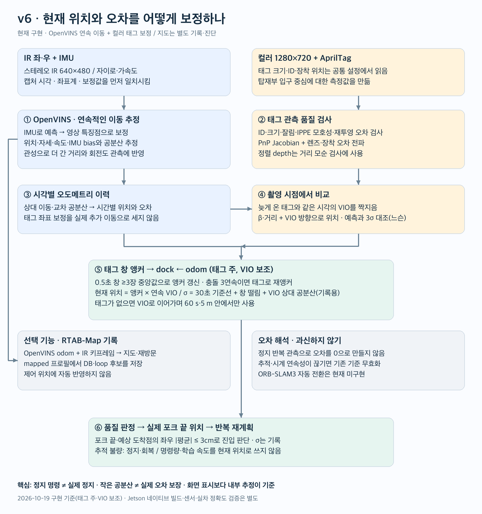
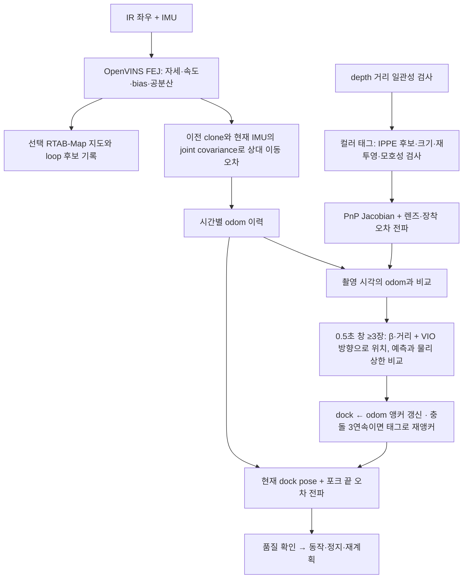
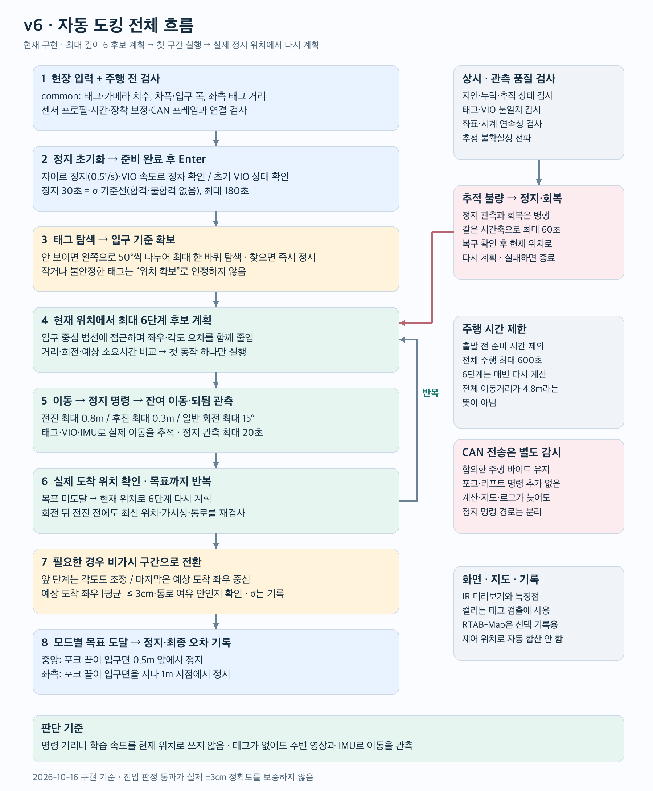

# v6 알고리즘과 구현

2026-10-16: 설계 검토 후 실행 코드 구현. Jetson 설치·네이티브 빌드·카메라·CAN 실물 검증은 아직 수행하지 않았다. [실행 순서](run.md)

도식은 이 v6 폴더의 `docs/images/`에 PNG와 편집 가능한 SVG로 함께 둔다. [오차 보정 PNG](docs/images/error_correction.png) · [전체 주행 PNG](docs/images/overall_flow.png). 코드 전송 시 이 문서와 도식도 함께 복사된다.

## 센서와 라이브러리

| 역할 | 구현/의존성 | 현재 상태 |
|---|---|---|
| 연속 이동·각도·bias | OpenVINS MSCKF/FEJ, stereo IR + IMU | ROS 2 C++ 브리지 및 Python 런타임 연결 |
| 입구 기준 측정 | pupil-apriltags + OpenCV IPPE | 컬러 1280×720, ROI/주기 검출, PnP 품질·공분산 검사 |
| depth | librealsense 컬러 정렬 depth | 태그 거리 일관성 검사. 독립 pose 업데이트로 더하지 않음 |
| 지연·누적 오차 | 시각별 VIO 이력 + 태그 창 기준 dock←odom 앵커 | 촬영 시각의 VIO 상태와 태그 β·거리로 0.5초 창(≥3장)마다 앵커 갱신, 태그 없으면 VIO만 (2026-10-19) |
| 장착 보정 | 정지 중 PnP 회전 블록 중앙값 (v4 camyaw) | 태그 정면에 눈대중 정차 → measure 기록 → preflight mount; CAN 안 엶; 공통 IR 장착 기준으로 저장 |
| 지도 | RTAB-Map ROS 2, 외부 OpenVINS odometry | mapped 프로필에서 지도 DB/loop 후보 기록. 제어 pose로 자동 채택하지 않음 |
| ORB-SLAM3 | 공식 소스 준비 | 실행 adapter/자동 전환 미구현. 기본 설치 제외 |
| WPILib / robot_localization | 보관한 공식 참고 소스 | 촬영 시각 보정·innovation 검사 참고. 실행 라이브러리로 중복 융합하지 않음 |

BASALT, VINS-Fusion, cuVSLAM, 별도 GTSAM smoother, 새 MPC/Reeds-Shepp 제어기는 기본 실행에 넣지 않았다. 기존 6단계 후보 계획과 CAN 동작을 유지하면서 관측 추정을 바꾼다. CAN 바이트·transport watchdog은 v5에서 그대로 복사했다.

## 입력 처리와 시간

한 Python 프로세스만 카메라를 소유한다. 같은 RealSense의 Motion Module과 영상 센서를 각각 SDK pipeline으로 열되 다른 프로그램이 장치를 중복 열지 않는다.

- IR 좌/우 640×480, 컬러 1280×720, depth 640×480, 30Hz 요청.
- 자이로 200Hz, 가속도 100Hz 요청. 가속도를 자이로 좌표계로 회전하고 양옆 표본으로 자이로 시각에 보간한다. 누락·역행은 세고 계속 간다(2026-10-19, v4 규칙; 3초 넘게 안 오면 정지 — `imu_age_s`, 2026-10-20 1→3 s). 큐 초과만 오류다.
- IR stereo는 SDK extrinsics와 실제 intrinsics로 rectification한다. OpenVINS에는 rectified pinhole과 그에 맞게 회전된 camera←IMU 변환을 전달한다. 임의 D455 예제 숫자를 복사하지 않는다.
- 프레임 hardware clock을 검사하고 dt는 device seconds로 계산한다. host monotonic은 지연/신선도 검사에만 쓴다. 장치 벽시계가 1970년이어도 적분 시간축을 대체하지 않는다.
- stereo 쌍의 실제 시각 차가 2ms를 넘으면 거부한다. 컬러 측정은 별도 촬영 시각에 맞춰 VIO 이력에서 보간한다. depth와 컬러 시간 차가 큰 경우 depth 보조 검사는 생략한다.
- 영상 큐는 최신 쌍 위주로 제한하고 IMU는 순서대로 전부 전달한다. 기존 오래된 이미지가 쌓여 뒤늦게 차량을 제어하지 않는다.

CPU 연산은 OpenVINS native worker, 컬러 태그 thread, JPEG thread, 로그 thread, 계획 process, CAN process로 분리했다. ROS reliable 전달이 느려져도 제어 supervisor와 CAN watchdog은 별도다. 이는 deadline을 감시하는 일반 Linux 구조이며 hard real-time 보장이 아니다.

## 위치와 오차 보정

그림과 아래 흐름은 현재 구현 기준이다. RTAB-Map은 선택적인 지도 기록·진단이며 제어 위치 보정에는 넣지 않는다. ORB-SLAM3 자동 전환은 미구현이다.

### 연속 이동과 절대 위치를 분리

`local_pose`는 OpenVINS의 연속 odom 좌표다. 태그가 입구 위치를 보정하는 `dock←odom` 변환은 별도로 유지한다. 명령 1m 후 실제 관측 이동이 1.2m라면 제어기의 progress는 관측 1.2m를 사용한다. 태그 보정으로 좌표가 20cm 변한 것은 물리적인 추가 이동 20cm로 기록하지 않는다.

OpenVINS 자체의 영상 업데이트는 상태를 계속 보정한다. 그 수치가 완벽한 물리 참값이라는 뜻은 아니다. frame gap/clone 연속성 소실·시각 역행·센서 epoch 변경 때는 기존 도킹 anchor와 동작 연속성을 무효화하고 정지한다. 학습한 속도·지연은 후보 시간과 제동 여유를 위한 값으로만 쓰고 pose에 적분하지 않는다.

### 추적·보정·주행 사용 가능 판정 (2026-10-16)

브리지는 OpenVINS 내부 `is_initialized_vio`로 초기 보정 완료를 읽는다. upstream `initialized()`는 일반 영상 업데이트 끝의 `timelastupdate != -1`까지 요구한다. 초기 clone 수집에서 일찍 반환한 뒤 정지 ZUPT만 계속 성공하면 이 조건은 영원히 false일 수 있다. 초기화 플래그, 상태 시각 일치, 추적·보정 품질을 별도로 검사하며 upstream 추정 알고리즘은 바꾸지 않는다.

`tracking_ok`는 초기화된 현재 시각의 상태와 **이전 영상에서 이어진 특징점 20개 이상**을 요구한다. 이번에 새로 검출한 점만 많아도 추적 성공으로 처리하지 않는다. `corrected_this_frame`는 ZUPT 또는 MSCKF/기존 stereo SLAM 특징점 합계 3개 이상의 보정 증거를 뜻한다. SLAM은 고정한 upstream의 완료 경로·양쪽 현재 관측·기존 landmark의 rejection counter를 함께 확인한다. 신규 landmark 초기화와 거절된 관측을 보정으로 세지 않는다.

`correction_recent`는 최근 0.2초에 위 보정이 있었는지 알려 주는 진단값이다. 이것 하나가 false라고 추적 실패로 처리하지 않는다. 연속 영상 추적·상대 pose 연속성·신선한 IMU·0.3초 이내 전달 지연을 만족할 때, 마지막 검증된 보정부터 **최대 1초**까지만 보정 사이의 추정을 `odom.ok`로 인정한다. 1초는 미검증 공학적 상한이며 실행 설정에서 더 길게 늘릴 수 없다. 보정 없이 특징점 수만 많다고 계속 주행하지 않는다. 실제 추적 소실에는 별도의 성공 유지 지연을 넣지 않는다.

`usable_for_docking`은 여기에 입구 기준 anchor·태그 충돌·전파된 불확실성·태그 미관측 시간/거리까지 검사한다. `odom.ok=true`가 ±3cm 정확도나 도킹 가능을 뜻하지 않는다. 보정 사이에도 covariance 전파와 포크 끝 오차 검사를 유지한다. 필터 상태 시각이 영상 시각과 맞지 않으면 그 값을 새 영상 시각의 pose로 저장하지 않고 anchor/history를 무효화한다.

### VIO의 원점 오차를 중복 계산하지 않음

OpenVINS의 초기 전역 원점·yaw는 임의 기준이다. 태그가 현재 입구 기준 위치를 알려주는데도 두 시점의 절대 covariance를 독립이라고 더하면 공통 원점 오차까지 두 번 센다.

C++ 브리지는 **직전 pose clone과 현재 IMU pose의 joint covariance(교차 공분산 포함)**에서 상대 SE(3) 이동의 covariance를 계산한다. JPL 회전 규약을 world left-rotation 규약으로 변환하고, camera/IMU에서 차량 기준으로 옮길 때 lever arm을 포함한다. ZUPT 경로도 다음 상대 covariance 계산을 위해 현재 pose의 correlated clone을 보존한다. 이전 clone 값이 이후 관측으로 바뀌었다면 그 변경량도 추가 오차 여유에 넣는다.

Python은 태그 anchor 이후의 상대 이동 불확실성을 전파한다. 시간적으로 독립이라고 가정하지 않고 표준편차를 누적하는 보수적 상계를 사용한다. 상대 covariance가 없는 구간을 임의로 작은 값으로 채우지 않는다. 이 구성은 1차 선형화와 센서 noise 모델을 사용하므로 실제 오차의 증명된 상한은 아니다.

### 태그 품질과 covariance

검출 ID/중복·hamming·decision margin, 최소 변 길이, 잘림, IPPE 두 해의 모호성, 재투영 오차를 검사한다. 작은 태그를 단순 검출했다는 이유로 180초 동안 탐색을 멈추는 동작은 피한다.

선택한 PnP 해 주변에서 8개 코너 좌표의 Jacobian으로 SE(3) covariance를 계산한다. corner noise는 설정한 최소값과 재투영 잔차 중 큰 값을 사용한다. 별도 렌즈 재보정 결과가 있으면 fx/fy/cx/cy와 왜곡 계수의 covariance도 전파한다. 장착각·위치 오차 및 최소 편향 여유를 추가한다.

이 계산은 **선택된 평면 해가 맞다는 조건**의 국소 근사다. 잘못된 branch, 잘못 입력한 태그 크기, 체계적인 왜곡을 필터가 자동 해결한다고 가정하지 않는다. depth는 일관된 유효 표본이 충분할 때 모순을 거부하며 독립 측정인 것처럼 두 번 합치지 않는다.

### 태그가 주, VIO가 보조 (2026-10-19 사용자 결정)

5초/300개 이력을 제한적으로 보관한다. 촬영 시각을 벗어나 외삽하거나 다른 센서 epoch를 연결하지 않는다. 지연 태그는 그 촬영 시각의 VIO 상태와 짝지어 쓴다.

실차 자료(2026-10-02 calibrate, 4.2 m ±30° 스윙)에서 PnP 방향·좌우는 자세마다 +4~−3° 치우쳤고, 믿을 수 있는 것은 화면 위치(β, 0.004°)·거리·자이로였다. 그래서 `fusion.py`는

- **방향** = VIO yaw + offset. offset 은 첫 태그 창에서 PnP 방향으로 잡고, 그 뒤에는 **서 있을 때만** 0.5 초마다 5 %씩 PnP 쪽으로 당긴다(약한 기준: 자이로·VIO 흐름 0.6°/60 s 는 잡고, 자세별 PnP 치우침 1~3° 는 한 정지에 20~40 %만 따른다). 움직일 때는 고정.
- **장착 yaw 는 주행 중 배운다**(2026-10-19, apriltag_v4/v5 조준각 c 의 역할). 출발 전 `mount`(눈대중 정면 정차)는 시작값일 뿐이다. 움직이는 동안의 태그 프레임(β·거리·VIO 자세·위치)을 다리 단위로 모아, "고정된 태그가 odom 좌표에서 한 점에 있어야 한다"는 조건으로 장착 yaw 오차 ε 를 최소제곱으로 푼다(`fusion.fit_mount_yaw`). **좋은 다리**(태그 5 m 안, |β| ≤ 10°, 0.5 m 넘게 감)만 같은 무게로 모아 중앙값을 쓰고, 그 값을 β 와 PnP 방향에 적용한다(ε 는 VIO 리셋을 넘어 유지). 10/1 자료로는 좋은 다리끼리 0.4° 안에서 맞았다(전환점 3.3 m 지렛대에서 2.3 cm). 좋은 다리가 하나도 없어도 전환점에서 그대로 들어간다(2026-10-19 사용자 결정: 그건 실패한 케이스로 받아들인다). 로그에 `entering_with_unlearned_mount_yaw` 만 남긴다.
- **위치** = 태그 자리 − R(방향)·(β·거리로 만든 몸체 기준 태그 벡터). 좌우 = 거리·sin(방향−β) 와 같은 식이다.
- **앵커(dock←odom)** = 0.5 초 창에 ≥3 장(apriltag_v4 WINDOW_S/MIN_N)의 중앙값. 서 있든 움직이든 태그가 보이면 창마다 갱신한다. 태그가 없으면 VIO 상대 이동으로만 이어 가고, 그 시간·거리는 `blind_time_limit_s`(60 s)·`blind_distance_limit_m`(5 m)로만 제한한다.
- **대조 검사(물리 상한, 2026-10-19 사용자 결정)** = 창의 프레임마다 VIO 예측과 비교해 어긋남이 `max(3 cm, 1 cm/m × 거리) + 0.29 m/s × 마지막 채택 창 이후 시간` 안이면 "동의". 동의가 절반 이상이면 그 프레임들로 앵커를 갱신하고, 아니면 그 창은 건너뛰고(`tag_jump_skipped`, 태그를 못 본 것과 같게 VIO 로 이어 감) 1초 넘게 계속 어긋나면 태그를 채택한다(`accepted_after_skip`). 세 숫자는 측정이 아니라 차·태그의 상수(도킹 허용 3 cm, 9/7 실측 3.7 m 좌우 잡음 39 mm, 정속 0.29 m/s)라 조용한 날 0 으로 줄지 않는다. 책상 위 실험(10/19)에서 3σ 방식은 σ 0.1 mm 에 0.05 mm 잔차를 충돌로 98번 셌다. 어느 쪽도 주행을 막지 않는다.

σ 는 **기록용**이다(어떤 판단에도 안 쓴다): σ² = 기준선(30 초 정지 태그 밀림, 거리에 비례해 키움, 바닥 1 cm·0.5°)² + 창 떨림(sd/√n)² + 앵커 이후 VIO 상대 공분산 합(+ 이동거리×σψ). 기준선은 출발 전 30 초(2026-10-19: 60 → 30 초, 10/1 자료 6 판 중 4 판이 30 % 안) 동안 자이로가 정지라 한 태그 프레임의 0.5 초 블록 중앙값 흩어짐이고, 앞·뒤 절반과 전체 중 큰 값이다. 합격·불합격이 없다. 정지가 확정되지 않았으면 가장 조용한 30 초를 쓰고 `source` 에 적으며, 태그를 못 봤으면 2026-10-02 실측(좌우 19 mm@4.2 m, 방향 1.5°)을 기본값으로 쓰고 그렇게 표기한다. 예전의 covariance intersection·innovation gate·×8 팽창은 없앴다.

### 정지 판정 — 자이로 (2026-10-19)

apriltag_v4 와 같다: 0.5 초 창의 |자이로 − bias| p90 ≤ 0.5°/s (bias 는 OpenVINS 추정치, 없으면 raw 이고 보고서에 적는다). 직진 관성은 자이로에 안 보이므로 VIO 속도 ≤ 0.03 m/s(정속 0.29 의 1/10, 사람이 정함)를 더하고, VIO 가 없으면 중립 명령 뒤 2 초(v4 SETTLE_S)로 본다. 명령이 중립이 아니면 정지가 아니다. 예전의 VIO 위치 4 mm/0.35° 창·6 초 진동 기준은 없앴다. `stationary_report` 에 자이로 p90·표본 수·출처·VIO 속도·규칙이 남는다.

### 포크 끝과 최종 진입

포크 길이 1.5m라면 yaw 오차가 좌우 끝점 오차로 확대된다. camera 원점뿐 아니라 포크 끝과 목표면까지 투영한 좌우와 그 σ 를 계산해 **기록**한다. 마지막 진입은 apriltag_v5 규칙대로 **예상 도착 좌우 |y| ≤ 3 cm 이면 들어간다**(2026-10-19). 예전의 |평균|+2σ 조건은 태그 한 장·3 m 에서 σ≈32 mm 라 통과할 수 없었다. 결정 때의 평균·σ 는 `lateral_check` 로 로그에 남긴다. 3 cm 를 넘으면 약한 회전으로 고치고(최대 5 회) 다시 잰다.

## 주행 흐름과 CAN

1. common·장치 모델·의존성 확인 → 정지 상태 OpenVINS 초기화 + 자이로 정지 5초 → READY.
2. Enter → 태그 미관측이면 왼쪽 50° 단위 최대 360° 탐색(찾으면 즉시 정지) → 태그가 보이는 자리에서 **30초 정차**(σ 기준선, `BASELINE`) → 첫 계획. 태그가 처음부터 보이면 바로 30초 정차(2026-10-19 사용자 결정: 탐색이 먼저, 기준선은 태그를 보며).
3. 입구 중심 법선에 접근하도록 거리·좌우·각도와 예상 소요시간을 비교하는 최대 깊이 6 후보 계획.
4. 첫 구간 실행. 회전/직진은 겹쳐 명령하지 않는다. 회전 뒤의 전진도 최신 정지 pose에서 통로·가시성·남은 거리를 다시 검사한다.
5. 실제 정지와 잔여 이동/되튐 관측 → 새로운 실제 도착 위치로 후보 재계획.
6. 태그가 잘릴 것으로 예상하는 전환점에서 정지·측정. 마지막 정렬은 투영 좌우 조건으로 판단하고 이전 구간에서는 각도도 줄인다.
7. 중앙: 포크 끝 입구 0.5m 전 정지. 좌측: 태그 자체 정면이 아닌 입구 중심으로 진입해 포크 끝이 입구를 지나 1m에서 정지.

전진 최대 0.8m, 후진은 현장 값 `rear_space_m`(0.5m), 일반 계획 회전 15°. 이는 전체 경로가 4.8m라는 뜻이 아니다. 준비 제외 전체 600초, 정지 관측 20초, 추적 회복 60초. 회복 시간은 정지 시작과 겹쳐 계산한다. 추적 실패를 확인하고 다시 60초를 무한 반복하지 않는다.

CAN transport는 기존 바이트를 보존한다. 0x1E3의 조향/주행 byte 외의 값은 neutral 127이며 회전·직진 동시 명령을 막는다. forward=67, slow=97, backward=187, left/right=157/97, fine=147/107. 별도 0x2E3 제어 프레임과 0x764 heartbeat, 독립 송신 lease/watchdog도 유지한다. TXACK는 차량 실제 움직임 응답으로 해석하지 않는다. 센서/계획/로그 실패는 supervisor가 정지시키고 supervisor 정지는 CAN lease가 감시한다.

## 장착·렌즈·현장 값

common은 v5/v6가 함께 쓰는 현장 값이다. 현재 미입력 차폭·통로 폭·좌측 태그 거리는 실제 값을 넣어야 한다. v6의 센서 noise·quality gate 등 엔지니어링 초기값은 `configs/runtime.json`에 두며 측정값이라고 표기하지 않는다.

장착각은 v4 camyaw 방식이다(2026-10-19 사용자 결정: 차를 움직이지 않음, CAN 없음). 태그 정면에 눈대중으로 세우고 30초 가만히 찍은 `measure` 로그를 `preflight mount` 가 읽어, 정지 중 PnP 회전의 0.5초 블록 중앙값을 장착 회전으로 저장한다. 차체 ∥ 법선은 가정이며 경고로만 적는다. 두 정지의 태그 위치 중앙값 차이가 카메라 좌표에서 본 전진 방향(몸체 x), 태그 세로 축이 몸체 z 다. 통과 조건은 없고 계산 불가(양 끝 태그 3장 미만, 이동이 끝점 흩어짐에 묻힘)만 저장을 막는다. 품질 수치는 `warnings` 로 기록한다. 측정된 회전은 raw left IR 기준으로 변환하여 common에 기록하고, 재장착하면 다시 잰다. 차를 태그 법선에 맞춰야 했던 서서 재는 방식, CAN 으로 5초 전진하던 mount-straight, 3차원 운동이 필요한 hand-eye 도구는 같은 날 지웠다. 오프라인 렌즈 도구는 결과를 검토하기 전에는 런타임에 자동 적용하지 않는다.

## 실제 설치·검증 범위

전용 venv/ROS workspace를 사용하는 설치 스크립트를 제공했다. OpenVINS는 검토한 commit을 고정하여 Jetson에서 빌드한다. RTAB-Map은 선택한 Jazzy 배포 패키지를 사용한다. 참고 소스 pin과 실제 apt 설치 버전은 별개이므로 장치의 패키지 버전도 기록해야 한다. 기본 구성에는 대형 신경망 가중치가 없다.

이 맥에서는 순수 Python의 센서 수학·지연/상관·복구·계획, 모의 CAN의 payload/정지 감시를 검사했다. ROS C++ 컴파일, RealSense 동시 스트림, native 처리량, 실차 최종 오차는 Jetson에서 확인해야 한다. `measure`와 `shadow`는 CAN을 열지 않으며 `drive --execute`만 실제 전송을 한다.

## 출처

- [OpenVINS 소스와 문서](https://github.com/rpng/open_vins): MSCKF/FEJ 및 clone covariance API, 코드 수정 없이 adapter에서 호출.
- [OpenCV calibration](https://docs.opencv.org/4.x/d9/d0c/group__calib3d.html): IPPE·camera calibration.
- [RTAB-Map ROS 2](https://github.com/introlab/rtabmap_ros/tree/ros2): external odometry와 stereo mapping.

### (삭제) 진동과 잔여 이동을 구분하는 정지 판정 (2026-10-16)

2026-10-19 자이로 정지 판정으로 대체했다(위 "정지 판정 — 자이로"). 6초 진동 기준·4 mm/0.35° 창·2배 허용 폭은 코드에서 없앴다.
