# Forklift docking — 전체 주행·오차 보정·세부 규칙

작성일: 2026-10-19 (Asia/Seoul)

분석 대상: `/Users/seojeongmin/krri/forklift-truck_docking`

[이미지 파일 목록](image_index.md) · [도식·표 갤러리](index.html)

이 문서는 앞선 채팅의 도식·설명을 내보낸 것이다. 실행 코드와 설정을 수정하지 않았다. 숫자는 분석 당시 맥의 코드·설정 기준이며, 젯슨의 `common.json`에 별도로 입력된 값은 다를 수 있다. 동작 설명은 소스 검사 결과이고, 실차 성공이나 정확도 보증을 뜻하지 않는다. 범위는 이 프로젝트의 제어·융합·센서 연결·보정·CAN 예외 규칙이며 OpenVINS 라이브러리 내부의 모든 수치 알고리즘을 열거한 문서는 아니다.

> **예시의 핵심 차이:** 현재 코드는 “여러 창이 계속 2.40m라고 합의하면 수용”하지 않는다. 마지막 앵커 수용 후 **1초가 지났으면**, 허용 범위를 벗어난 현재 창도 수용할 수 있다. 서로 다른 창들이 같은 값으로 유지되는지 검사하는 조건은 없다.

## 1. 전체 주행 알고리즘

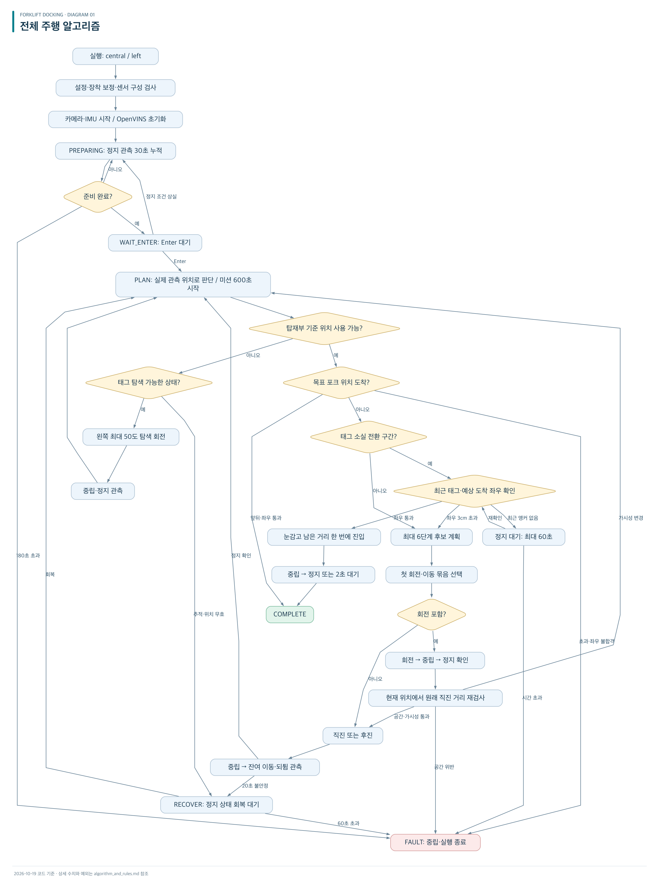

[확대용 SVG](diagrams/01-overall-flow.svg) · [Mermaid 원문](diagrams/01-overall-flow.mmd)

### 전체 흐름의 주요 값

| 항목 | 현재 구현 |
|---|---|
| 중앙 모드 목표 | 포크 앞끝이 입구면 0.5m 전 |
| 좌측 모드 목표 | 포크 앞끝이 입구면을 지나 1m |
| 계획 깊이 | 최대 6단계. 반드시 6개 생성 또는 6번 안에 도착하는 뜻은 아님 |
| 실행 범위 | 계획 중 첫 번째 회전·이동 묶음 |
| 재계획 | 이동 후 정지하면 오차 크기와 관계없이 다시 계획 |
| 회전 직후 | 정지 후 같은 묶음의 원래 직진을 이어 갈 수 있음. 매 회전 직후 무조건 6단계 재계획하지 않음 |
| 태그 탐색 | 현재 왼쪽 최대 50도씩, 누적 약 360도 제한. 과거 대화의 60도와 다름 |
| 일반 전진 | 한 번 최대 0.8m |
| 후진 | 현재 rear_space_m=0.5m. 현장 설정이 한 번 후진 상한을 결정 |
| 계획 회전 | 한 번 최대 15도 |
| 눈감고 진입 | 남은 거리 전체를 한 번에 수행. 일반 전진의 0.8m 제한을 그대로 적용하지 않음 |
| 전진 바이트 | 67 사용. 97 저속 전진은 목록에 있으나 현재 주행 계획에서는 사용하지 않음 |

[표 이미지 1/2](tables/01-main-parameters-01.png) · [표 이미지 2/2](tables/01-main-parameters-02.png)

### 후보 계획 생성

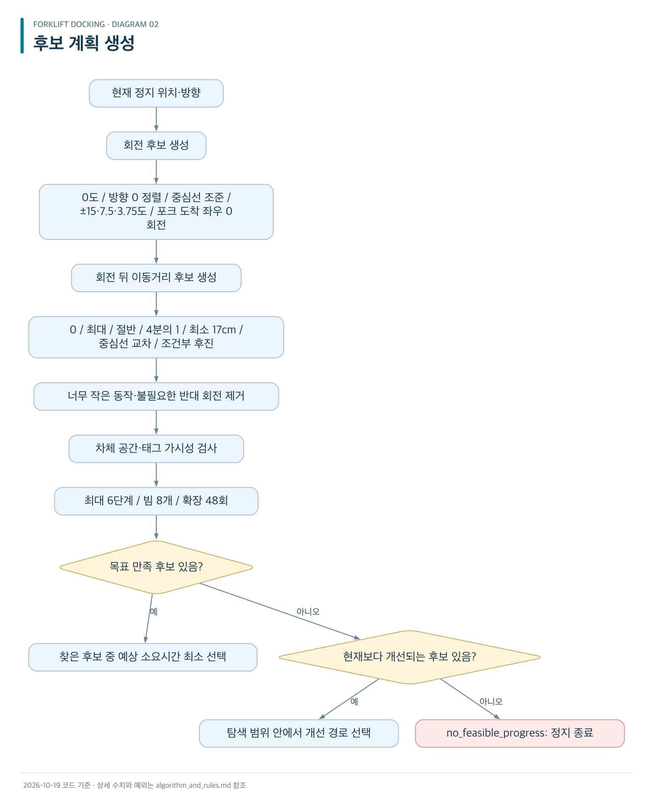

[확대용 SVG](diagrams/02-candidate-planning.svg) · [Mermaid 원문](diagrams/02-candidate-planning.mmd)

- 전환점 1.5m 전부터 약한 회전 강도를 사용한다.
- 전환점 15cm 전부터 마지막 정렬로 보고 독립적인 방향 목표를 뺀다. 그 전에는 좌우와 방향을 함께 줄인다.
- 마지막에도 각도는 예상 포크 도착 좌우 계산에 들어간다.
- 찾은 목표 만족 후보 중 예상 소요시간 최소를 선택한다. 전역 최단거리 보장은 없다.
- 탐색 계산 예산은 planning_timeout_s의 80%(기본 2.4초), 상위 계획 응답 제한은 3초다.
- 공간 검사는 입구 안쪽에 들어온 차체 부분의 좌우 폭을 검사한다. 회전 약 2도, 이동 약 2.5cm 간격으로 명목 경로를 샘플링한다.

## 2. 오차·드리프트·관성 보정 개요

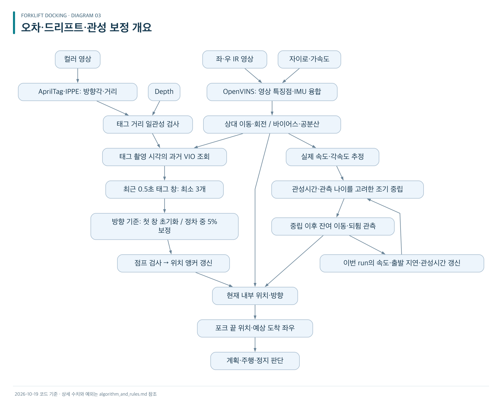

[확대용 SVG](diagrams/03-error-correction.svg) · [Mermaid 원문](diagrams/03-error-correction.mmd)

### 센서와 추정값의 역할

| 입력 | 실제 역할 |
|---|---|
| 컬러 태그 | 탑재부 기준 위치를 다시 잡는 주된 기준 |
| PnP 방향 | 최초 방향 기준 설정 + 정차 시 약한 방향 보정 |
| IR 스테레오 + IMU | OpenVINS에서 상대 이동·회전을 계속 추적 |
| Depth | 태그 거리 일관성 검사. 별도의 위치 측정으로 중복 융합하지 않음 |
| 차량 반응 추정값 | 후보 소요시간·예측 정지에 사용 |
| σ·공분산 | 불확실성 계산·기록. 현재 좌우 진입 기준에는 σ를 더하지 않음 |

[표 이미지](tables/02-sensor-roles.png)

관성 때문에 명령보다 더 움직이면 정상 추적 중에는 추가 이동한 만큼 VIO 위치가 갱신된다. 다음 계획은 그 관측 위치에서 시작한다. 다만 눈감고 진입 도중 VIO를 잃으면 시간 모델로 끝내는 예외가 있어, 그 구간은 실제 이동량을 끝까지 관측했다고 볼 수 없다.

## 3. 태그 창 수용·건너뛰기·앵커 갱신

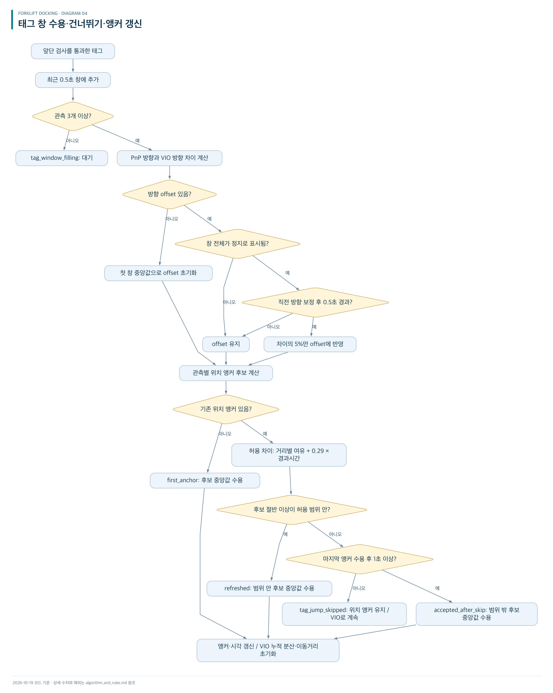

[확대용 SVG](diagrams/04-tag-anchor-update.svg) · [Mermaid 원문](diagrams/04-tag-anchor-update.mmd)

```text
허용 차이[m] = max(0.03, 0.01 × 태그 거리[m])
              + 0.29 × 마지막 앵커 수용 이후 시간[s]
```

비교 대상은 태그 거리 숫자의 단순 변화가 아니라 **VIO 이동을 반영한 앵커 후보와 기존 앵커의 2차원 차이**다. 실제로 60cm 이동했고 VIO도 그것을 관측했다면, 태그 거리가 60cm 줄어도 앵커 차이는 작을 수 있다.

### 앵커 갱신 케이스

| 상황 | 현재 처리 |
|---|---|
| 태그 창에 1~2개 | 최소 3개까지 대기 |
| 첫 유효 창 | 방향 offset과 위치 앵커 초기화 |
| 후보 절반 이상이 기존 앵커와 일치 | 일치 후보들만 모아 중앙값으로 갱신 |
| 일치 후보 절반 미만 + 마지막 수용 후 1초 미만 | 위치 앵커 갱신 건너뜀 |
| 일치 후보 절반 미만 + 마지막 수용 후 1초 이상 | 불일치 후보들의 중앙값 수용 |
| 태그 없음·앞단 검사 탈락 | 앵커 유지, VIO로 이어 감 |
| 추적 기준 재설정 | 앵커·offset·태그 창 초기화 |

[표 이미지](tables/03-anchor-cases.png)

### 2.90m·2.40m 예시

약 3m 거리, 마지막 수용 이후 0.5초라면 허용 차이는 3cm + 0.29m/s × 0.5s = **17.5cm**다. 아래의 “차이”는 VIO 대비 앵커 차이라고 가정한다.

| 예시 | 실제 규칙 |
|---|---|
| 2.90m → 차이 10cm | 후보 절반 이상이 해당 범위이면 수용 |
| 2.40m → 차이 60cm, 0.5초 시점 | 건너뜀 |
| 마지막 수용 후 1초 경과, 여전히 60cm 차이 | 현재 구현은 수용할 수 있음 |
| 2.40 → 2.10 → 2.60처럼 창마다 달라짐 | 창 사이 일관성 검사 없음. 1초 이후 수용 가능 |
| 태그를 한참 못 보다가 재검출 | 이미 마지막 수용 후 1초가 지났다면 불일치 창도 즉시 수용 가능 |

[표 이미지](tables/04-jump-examples.png)

- 창은 최근 0.5초를 유지하는 **겹치는 창**이다. 독립 창을 0.5초마다 한 번 처리하는 구조가 아니다.
- 최소 3개만 있으면 처리하므로 반드시 0.5초 전체가 차야 하는 것도 아니다.
- “절반 이상”이므로 정확히 50%도 수용 조건에 들어간다.
- 위치 점프 검사 **전에 방향 offset을 보정**한다. 위치 앵커 갱신을 건너뛰어도 정차 중 방향은 조금 바뀔 수 있다.
- 0.29m/s는 명목 전진속도다. 회전·측정오차까지 엄밀하게 증명한 물리적 상한이 아니다.
- `accepted_after_skip`은 태그 우선 정책이며, 앞선 기준이 틀렸음을 검증했다는 뜻이 아니다.

## 4. 태그 검출부터 융합까지의 탈락 규칙

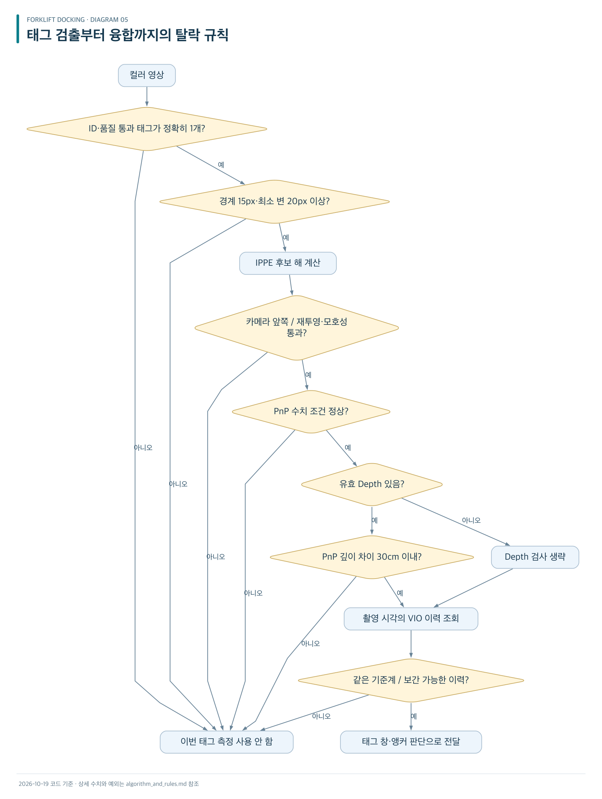

[확대용 SVG](diagrams/05-tag-rejection.svg) · [Mermaid 원문](diagrams/05-tag-rejection.mmd)

### 태그·Depth·시각 검사

| 검사 | 기준 / 실패 시 처리 |
|---|---|
| 태그 종류·ID | tag36h11, 현재 ID 1 |
| 검출 margin | 20 이상 |
| Hamming | 0 이하: 오류 비트 수정 없는 검출 |
| 일치 태그 개수 | 정확히 1개. 없거나 중복이면 탈락 |
| 화면 경계 | 최소 여백 15px |
| 태그 크기 | 네 변 중 최소 길이 20px |
| PnP 깊이 | 꼭짓점 모두 카메라 앞쪽 |
| 재투영 오차 | 2px 이하 |
| 두 해 모호성 | 최선/차선 오차 비율 0.8 이하 |
| PnP 수치 조건 | 유한한 정보행렬, 조건수 10¹² 이하 |
| Depth 범위 | 0.3m 초과~8m 미만 |
| Depth 표본 | 유효 비율 50% 이상, 최소 12개 |
| Depth 표면 혼합 | 90백분위−10백분위 ≤ 0.1m |
| Depth와 PnP 차이 | 0.3m 이하 |
| Depth 없음·부족·혼합 표면 | Depth 검사 생략. 태그를 무조건 버리지 않음 |
| 태그 촬영 시각의 이력 없음 | capture_outside_history 등으로 융합 거부 |
| 이력 기준계 다름 | history_epoch_unavailable |
| 보간할 VIO 두 상태 간격 | 0.15초 초과이면 history_gap |
| 이력 보관 | 최대 5초 / 300개 |

[표 이미지 1/2](tables/05-tag-depth-checks-01.png) · [표 이미지 2/2](tables/05-tag-depth-checks-02.png)

검출은 기본 0.15초 간격, 전체 화면 재탐색은 1초 간격이다. 나머지는 직전 태그 주변 영역을 활용한다. 작거나 잘린 태그는 탐색 회전을 멈추게 하는 유효 후보가 아니다. 크기는 충분하지만 PnP가 모호한 태그는 정지 재관측을 유도할 수 있다.

## 5. VIO 품질·드리프트·정지 판단

### VIO 유효성

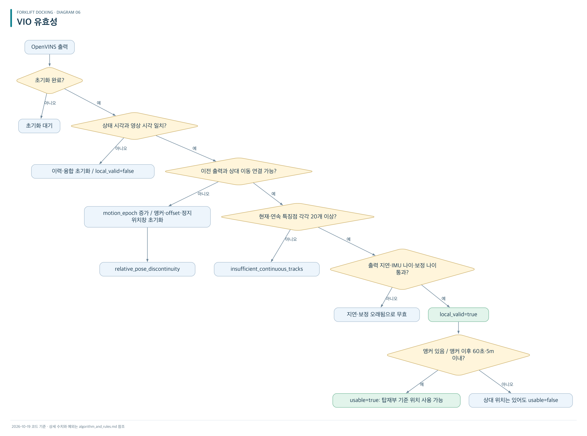

[확대용 SVG](diagrams/06-vio-validity.svg) · [Mermaid 원문](diagrams/06-vio-validity.mmd)

실제 `quality()`는 초기화→시각→특징점→연속성→지연→IMU 나이→보정 나이 순으로 첫 실패 이유를 보고한다. 위 도식은 기준 재설정 동작을 설명하기 위해 연속성을 앞에 배치했다.

### VIO 품질·유효기간

| 항목 | 기준 |
|---|---|
| 영상·상태 시각 차이 | 10⁻⁵초 미만 |
| 연속성 | 같은 epoch, delta_valid, 이전 시각 연결, 상태 간격 0.4초 이하 |
| 특징점 | 현재와 이전부터 이어진 특징점 각각 최소 20개 |
| 이번 출력 보정 판단 | ZUPT 또는 MSCKF+SLAM 보정 특징점 합계 3개 이상 |
| 마지막 보정 이후 | 최대 1초 |
| VIO 품질 검사 전달 지연 | 최대 1초 |
| 정지 상태 제어 판단 | 관측 나이·전달 지연 각각 최대 0.3초 |
| 이동 상태 제어 판단 | 관측 나이·전달 지연 각각 최대 1초 |
| IMU 나이 | 최대 1초 |
| 태그 상태 표시 | 유효기간 0.7초 |
| 앵커 이후 위치 사용 한계 | 60초 / 누적 상대 이동 5m |

[표 이미지](tables/06-vio-quality.png)

### σ 처리

```text
기록용 σ² = 출발 전 태그 흔들림 기준선²
            + 현재 앵커 창의 흔들림²
            + 앵커 이후 VIO 누적 분산
```

- 기준선: 정지 태그 관측 30초. 없으면 가장 조용한 구간, 그것도 없으면 과거 기본값.
- 위치 σ 하한 1cm, 방향 σ 하한 0.5도. 거리 증가에 따라 기준선도 확대한다.
- 앵커 창의 흔들림 계산에는 표준편차/√표본수가 사용된다. 연속 프레임의 상관오차를 엄밀하게 제거했다는 뜻은 아니다.
- VIO 방향 분산은 누적 이동거리를 통해 위치 분산에도 반영한다.
- 앵커 수용 시 앵커 이후 VIO 분산·이동거리 초기화.
- σ는 진입 차단에 사용하지 않고 기록한다.
- PnP 공분산은 계산하지만 현재 Fusion은 그것으로 칼만 이득을 계산해 태그를 융합하지 않는다.

### 정지 판단

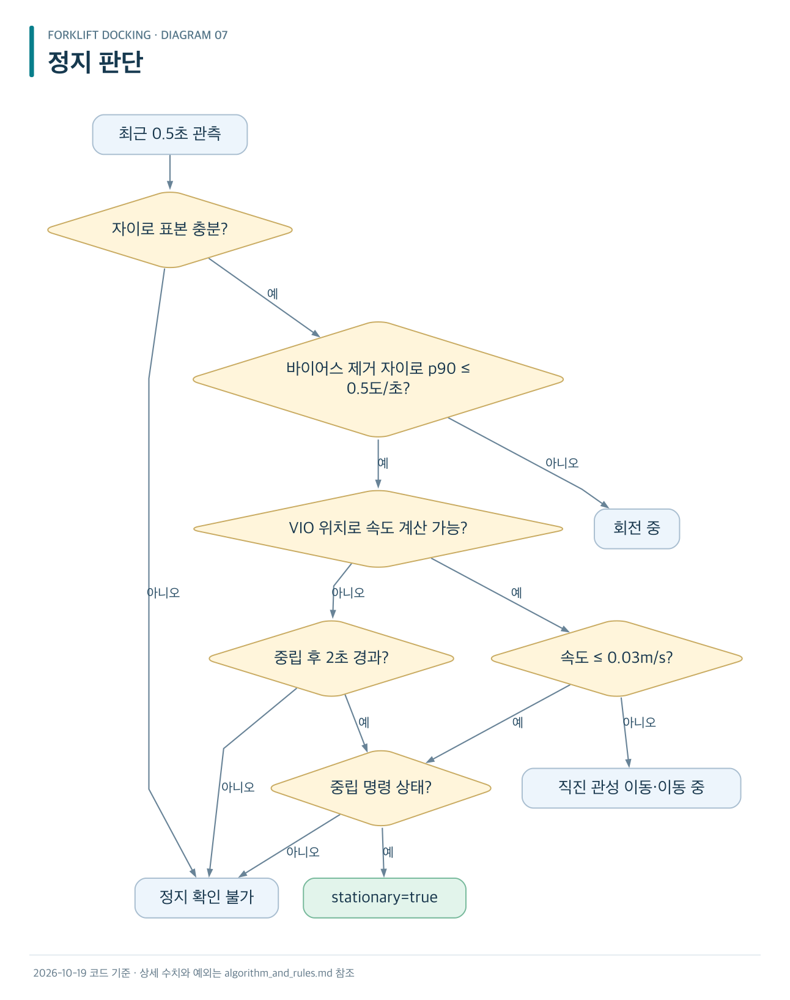

[확대용 SVG](diagrams/07-stationarity.svg) · [Mermaid 원문](diagrams/07-stationarity.mmd)

- 원시 자이로를 우선 사용하고, 부족하면 VIO 패킷 자이로 크기 표본을 사용한다.
- VIO 속도는 창의 처음·끝 위치 차이로 계산한다. 창 안의 모든 왕복 흔들림을 완벽하게 검출하지는 않는다.
- 실행 시 생성 설정은 OpenVINS ZUPT를 **초기 구간에만 활성화**한다.
- 매 주행 후 정지 판정을 OpenVINS에 전달해 강제로 속도를 0으로 보정하는 연결은 현재 없다.

## 6. 관성·되튐·출발 지연

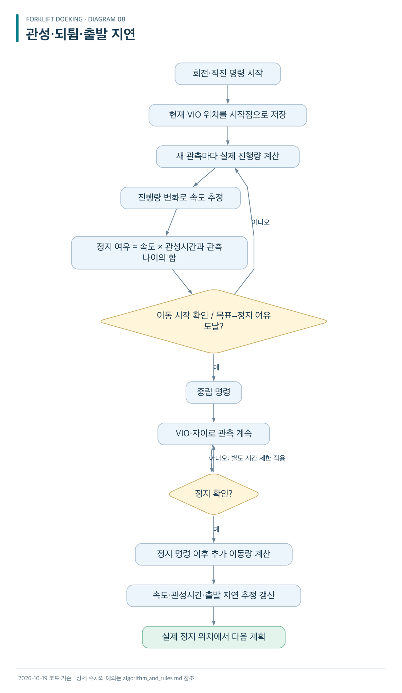

[확대용 SVG](diagrams/08-inertia-rebound.svg) · [Mermaid 원문](diagrams/08-inertia-rebound.mmd)

### 관성 보정·학습 규칙

| 항목 | 실제 처리 |
|---|---|
| 직진 진행량 | 시작 방향으로 투영한 VIO 변위 |
| 회전 진행량 | VIO 방향 변화, 좌·우 명령에 따라 부호 처리 |
| 실제 이동 시작 | 진행량 > 0.005. 직진 m, 회전 rad |
| 속도 필터 | 이전 속도 65% + 새 관측 속도 35% |
| 정지 여유 | max(속도, 0) × (추정 관성시간 + 관측 나이) |
| 목표 전 정지 | 실제 이동을 확인한 뒤에만 적용 |
| 반대 방향 이동 | 직진 −3cm 미만 또는 회전 −2도 미만이면 오류 |
| 반응 학습 | 정지 확인 및 같은 추적 기준 유지 시 |
| 학습 비율 | 기존 추정 50% + 새 관측 50% |
| 속도 학습 조건 | 동작 0.2초 초과, 진행량 양수, 유한값, 속도 0.002~1 범위 |
| 관성시간 | 추가 이동량÷속도, 0~2초 제한 |
| 출발 지연 | 명령부터 이동 시작까지, 0~5초 범위 |
| 저장 기간·용도 | 이번 run 내 추정. 센서 위치를 직접 바꾸지 않음 |

[표 이미지 1/2](tables/07-inertia-rules-01.png) · [표 이미지 2/2](tables/07-inertia-rules-02.png)

되튐은 최종 관측 위치에는 반영되지만 반응 학습의 잔여 이동량은 `max(0, 최종 진행량−정지 명령 시 진행량)`이다. 음의 되튐을 별도의 반동 모델로 학습하지 않는다.

### 차량 반응 초기값

| 동작 | 초기 속도 | 초기 관성시간 | 초기 출발 지연 |
|---|---|---|---|
| 전·후진 | 0.28973m/s | 0.4초 | 1.498초 |
| 일반 회전 | 12.01도/s | 0.283초 | 1.082초 |
| 미세 회전 | 8.47도/s | 0.168초 | 1.082초 |

[표 이미지](tables/08-motion-initial-values.png)

위 값은 명령·계획을 위한 초기 추정이며 실측 정확도 보증값이 아니다.

## 7. 눈감고 진입

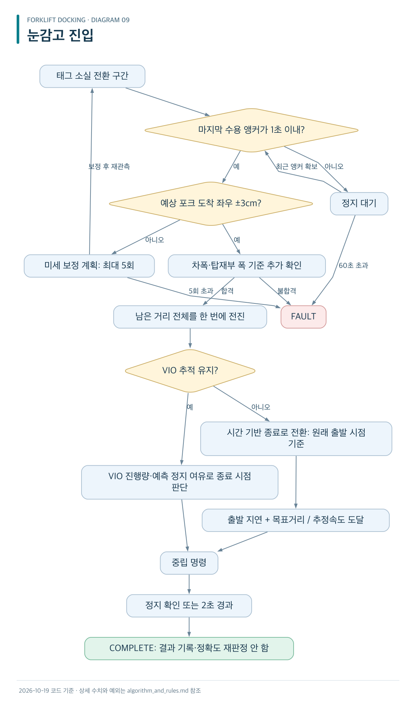

[확대용 SVG](diagrams/09-blind-entry.svg) · [Mermaid 원문](diagrams/09-blind-entry.mmd)

### 눈감고 진입의 예외

| 상황 | 처리 |
|---|---|
| VIO 정상 | 실제 상대 진행량으로 종료 시점 판단 |
| VIO 지연·추적 기준 변경 | 시간 기반 종료로 전환 |
| VIO 다시 회복 | 해당 동작에서는 시간 기반 유지 |
| 시간 기반 목표 | 출발 지연 + 전체 목표거리 / 추정속도 |
| 시간 기준 시작점 | 추적을 잃은 순간이 아니라 원래 전진 시작 시점 |
| 종료 후 정지 확신 없음 | 중립 후 2초가 지나면 완료 처리 가능 |
| 종료 후 좌우·앞뒤 오차 | 기록하지만 이 경로에서는 합격 여부 재검사 안 함 |
| IMU 오래됨·센서 작업자 종료·CAN deadman | 상위 감시가 별도로 정지시킬 수 있음 |

[표 이미지](tables/09-blind-exceptions.png)

시간 기반 분기는 일반 경로의 공간·진행방향 검사보다 먼저 반환한다. `hold_s` 도달도 먼저 검사하므로 일반 직진 15초 제한이 모든 시간 기반 종료에서 동일하게 적용되는 구조는 아니다. “어떤 오류가 나도 계속 간다”는 뜻은 아니다.

## 8. 주행 상태별 규칙

### 상태 전환·종료 사유

| 상태·상황 | 처리 |
|---|---|
| PREPARING 정상 정지 | 새 관측의 시간 간격을 누적해 30초 준비 |
| 준비 중 짧은 흔들림 | 같은 추적 기준·위치 4mm·방향 0.35도 이내, 중단 3초 이내이면 준비 시간 보존 가능 |
| 준비 중 이동·기준 변경·오래된 관측 | 준비 시간 초기화 |
| 준비 180초 초과 | preparation_timeout |
| WAIT_ENTER에서 정지 조건 상실 | PREPARING으로 돌아감 |
| Enter | 미션 600초 타이머 시작 |
| PLAN인데 정지 확인 불가 | RECOVER |
| 절대 위치 없음·태그 없음 | 왼쪽 탐색 회전 |
| 태그 보이나 아직 사용 불가 | 정지 태그 합의 대기 |
| 최근 2초 안에 태그 후보를 봄 | 즉시 재회전하지 않고 기다림 |
| 탐색 중 유용한 태그 후보 발견 | 중립 → 정지 → 다시 판단 |
| 탐색 시간·각도 소진 | search_exhausted / search_360_exhausted |
| 탐색 중 VIO 상실 | search_tracking_lost_unmeasured_angle |
| 계획 중 관측 상실 | RECOVER |
| 계획 결과 도착 시 위치 변경 | 위치 1cm·방향 0.5도 초과 또는 epoch 변경이면 재계획 |
| 이전 계획 ID 응답 | 무시 |
| 계획기 예외 | planner 오류 종료 |
| 개선 후보 없음 | no_feasible_progress |
| 일반 이동 중 추적 상실 | 중립 → RECOVER |
| 일반 이동 중 절대 위치 무효 | pose_untrusted → 회복 대기 |
| 탑재부 차체 공간 위반 | bay_side_clearance |
| 정지 후 20초 동안 불안정 | RECOVER로 이동 |
| 위 회복의 시간 기준 | 정지 명령 시점부터 60초. 20+60=80초가 아님 |
| 회복 중 정지·위치 확보 | PLAN |
| 회복 시간 초과 | recovery_timeout |
| 일반 목표보다 5cm 넘게 지나침 | target_overshoot |
| 일반 목표 앞뒤 ±5cm·좌우 통과 | COMPLETE |
| 앞뒤 도착·좌우 실패 | target_reached_with_lateral_error |
| FAULT·COMPLETE | 정지 명령 상태로 종료 |

[표 이미지 1/3](tables/10-state-rules-01.png) · [표 이미지 2/3](tables/10-state-rules-02.png) · [표 이미지 3/3](tables/10-state-rules-03.png)

좌우 허용치는 `min(3cm, (탑재부 폭−차폭)/2)`다. 현재 1.4m−1.3m이면 한쪽 여유 5cm, 제어 허용치는 3cm다.

### 주행 타임아웃 한눈에 보기

| 제한 | 기본값 | 도달 시 |
|---|---|---|
| 출발 준비 | 180초 | FAULT |
| Enter 이후 미션 | 600초 | mission_timeout |
| 태그 탐색 | 180초 / 누적 약 360도 | 탐색 종료 |
| 탐색 한 회전 | 15초 | motion_time_limit |
| 일반 회전 | 8초 | motion_time_limit |
| 일반 직진·후진 | 15초 | motion_time_limit |
| 계획 응답 | 3초 | planner_timeout |
| 동작 후 정지 관측 | 20초 | RECOVER |
| 추적 회복 | 60초 | recovery_timeout |
| 눈감기 직전 최근 앵커 대기 | 60초 | recent_tag_before_blind_timeout |
| 전환점 보정 계획 | 최대 5회 | transition_corrections_exhausted |

[표 이미지](tables/11-timeouts.png)

## 9. 센서 누락·재시작

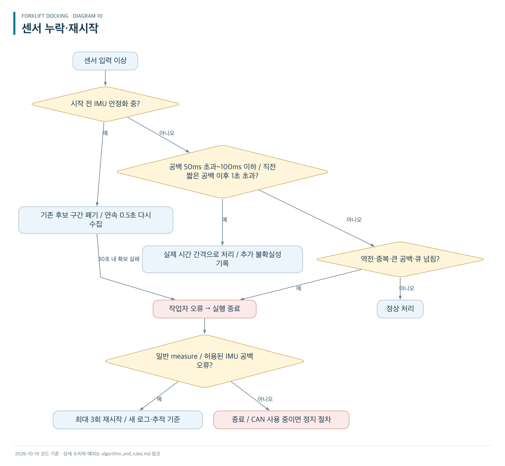

[확대용 SVG](diagrams/10-sensor-restart.svg) · [Mermaid 원문](diagrams/10-sensor-restart.mmd)

### 센서·시간 검사

| 항목 | 조건·시간 | 결과 |
|---|---|---|
| 영상 첫 수신 | 완전한 IR 좌·우+컬러 30초 내 | 초과 오류 |
| 영상 운용 중 | 새 완전 프레임 2초 없음 | 오류 |
| IMU 초기 안정화 | 장치·도착 시간 모두 연속 0.5초 | 준비까지 VIO 영상 입력 보류 |
| IMU 초기 안정화 제한 | 30초 | 오류 |
| ROS DDS 연결 | 양방향 20초 | 실패 오류 |
| OpenVINS 출력 | 첫 영상 입력 또는 마지막 출력 이후 10초 | 출력 timeout |
| 상위 카메라 시작 감시 | 관측 전혀 없음 55초 | 오류 |
| 좌·우 IR 시각 차이 | 2ms 초과 | unsynchronized_stereo |
| Depth·컬러 시각 차이 | 25ms 초과 | Depth 검사 생략 |
| IMU 정상 간격 | 50ms 이하 | 정상 |
| 고립된 짧은 공백 | 50~100ms, 직전 짧은 공백과 1초 초과 간격 | 허용 |
| 짧은 공백 분산 추가 | 위치 각 축 (0.03m)²·방향 (2도)² | 기록용 분산 증가 |
| 반복 공백·100ms 초과 | 운용 중 | 오류 |
| IMU 시각 역전·중복 | 운용 중 | 오류 |
| IMU 큐 | 4,096개 초과 | 오류 |
| 가속도 보간 불가 | 양쪽 표본 없음·간격 초과 | 오류 |
| 동일 스테레오 반복 | 완전히 동일 프레임 | 건너뜀 |
| 프레임 번호 감소·시각 증가 | 번호 이상 | 기록 후 계속 |
| 새 프레임 시각 감소·정지 | 연속성 실패 | 오류 |
| 장치 시계 wrap | 약 71.6분, wrap으로 인식 | 연속 시간 보정 |
| 오래된 네이티브 영상 입력 | 큐 대기 0.3초 초과 | 해당 영상 버림 |
| 일반 measure의 지정 IMU 오류 | sample_gap·보간 공백·unbracketed_imu | 최대 3회 재시작 |
| 실주행·shadow·자동 직진 보정 | 같은 오류 | 자동 재실행 안 함 |

[표 이미지 1/3](tables/12-sensor-time-rules-01.png) · [표 이미지 2/3](tables/12-sensor-time-rules-02.png) · [표 이미지 3/3](tables/12-sensor-time-rules-03.png)

### 큐가 밀리는 경우

| 데이터 | 처리 |
|---|---|
| 영상·태그 작업·미리보기 | 최신 항목으로 이전 항목 교체 |
| IMU | 순서 보존, 넘치면 오류 |
| ROS 상태 버퍼 | 최대 32개, 넘치면 오래된 상태 제거·누락 횟수 증가 |
| 태그 대기 버퍼 | 최대 32개, 오래된 태그 제거 |
| 제어 관측·계획 요청 | 크기 1 큐 중심, 최신 상태 사용 |
| 로그 큐 | 최대 4,096개, 넘치면 로그 누락 카운트 증가 |

[표 이미지](tables/13-queues.png)

상태 누락은 상대 변환 연결 실패로 이어질 수 있지만, 실제 relative_pose_discontinuity의 원인이 항상 이것이라는 뜻은 아니다.

## 10. CAN·deadman·작업자 종료

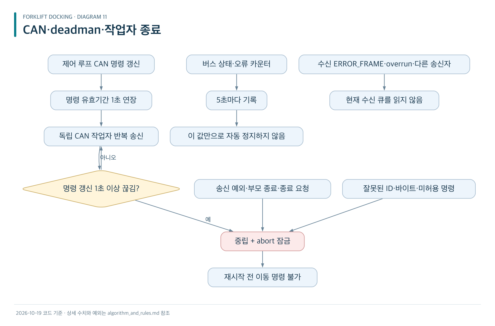

[확대용 SVG](diagrams/11-can-deadman.svg) · [Mermaid 원문](diagrams/11-can-deadman.mmd)

### CAN 보호·종료 조건

| 조건 | 현재 처리 |
|---|---|
| 명령 lease 만료 | 중립 + 잠금 |
| CAN 프로세스 사망 | 상위 루프 종료 |
| CAN 작업자 갱신 1초 초과 없음 | CAN watchdog/transport |
| 이동 중 상위 루프 1초 초과 정체 | supervisor deadline missed |
| 송신·writeSync 예외 | 작업자 오류·정지 절차 |
| 미허용 명령·ID·바이트 | 거부 |
| 포크 리프트 바이트 | 중립 127만 허용 |
| 공유 잠금 충돌 | 최대 1초 대기. 실패 시 기존 lease 연장 안 함 |
| 이동 중 stop 전달 실패 | abort 잠금 |
| 이미 stop인데 반복 stop 전달 실패 | 이것만으로 새 abort를 걸지 않음 |
| 부모 프로세스 종료 | 중립 전송·종료 절차 |
| Ctrl+C / s·q·stop+Enter / SSH EOF | 종료·CAN 정지 절차 |
| CAN 초기화 응답 | 최대 5초 대기 |
| 정상 펄스 종료 시각 | 중립 전환, 정상 종료 자체는 abort로 잠그지 않음 |

[표 이미지 1/2](tables/14-can-rules-01.png) · [표 이미지 2/2](tables/14-can-rules-02.png)

현재 CAN은 송신 전용이다. ERROR_FRAME 수신 즉시 중단·TXACK 감시는 적용되지 않는다. 버스 상태 조회 자체는 정지하지 않지만 송신 함수가 오류를 반환하면 별도 오류 경로로 종료될 수 있다. 소프트웨어 중립 전송은 물리적 제동 성공의 확인이 아니다.

## 11. 초기 직진 장착 보정

현재 실제 펄스는 과거 대화의 3초가 아니라 **5초**다.

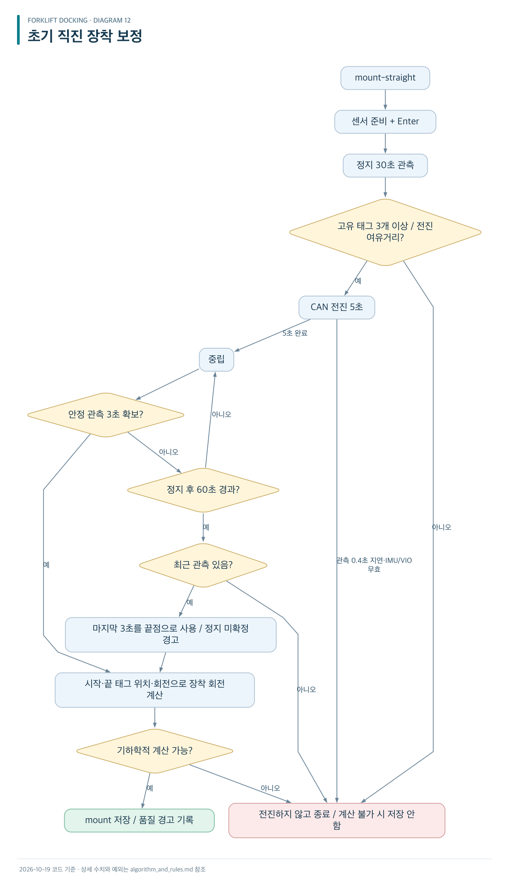

[확대용 SVG](diagrams/12-mount-straight.svg) · [Mermaid 원문](diagrams/12-mount-straight.mmd)

### 장착 보정 규칙

| 항목 | 저장·진행 판단 |
|---|---|
| 처음 heading 0 | 필요 없음 |
| 기본 가정 | 태그 수직, 평평한 이동, 조향 고정·옆미끄럼 없음 |
| 시작·끝 태그 | 각각 고유 관측 최소 3개 |
| 시작 정지 비율 80% 미만 | 현재 경고만 하고 진행 |
| 전진 여유거리 | 포크 길이 + (5초 + 관성시간) × 초기 속도 |
| 포크 1.5m 기준 | 카메라에서 태그까지 약 3.06m 이상 필요 |
| 전진 중 관측 지연 | 0.4초 초과 시 중단 |
| 전진 중 VIO 무효 | 중단 |
| 시작·끝 VIO 기준 변경 | 가능한 경우 태그 회전으로 방향 변화 보완 |
| 센서 시간 기준 변경 | 연결 불가 → 저장 거부 |
| 이동거리 | 5cm 이상, 끝점 흩어짐 합의 2배보다 커야 함 |
| 큰 회전·흩어짐·기울기·방향 σ | 다수 품질 조건은 경고만 기록 후 저장 |
| 계산 불가·절차 미완료 | 저장 안 함 |
| 측정 중 common 변경 | 덮어쓰기 거부 |
| 전체 제한 시간 | 90~300초, 기본 180초 |
| 복귀 | 자동 후진 없음. 수동 복귀 |

[표 이미지 1/2](tables/15-mount-rules-01.png) · [표 이미지 2/2](tables/15-mount-rules-02.png)

실행 안내 문자열 일부는 아직 “3초 전진”이라고 하지만 실제 제어 상수 PULSE_S는 5초다.

## 12. 그 밖의 종료·경고 규칙

### 환경·작업자·기록 예외

| 상황 | 처리 |
|---|---|
| 장착 보정 없음·입력 서명 불일치 | drive/shadow 거부 |
| 카메라 serial·해상도·내부 파라미터 변경 | 시작 거부 |
| 왼쪽 모드의 좌측 태그 거리 미입력 | 실주행 거부 |
| 차폭·탑재부 폭·뒤 공간 누락·오류 | 설정 검사 실패 |
| factory extrinsics 조회 불가 | 시작 실패 |
| 지원하지 않는 렌즈 모델·미검증 보정값 | 시작 실패 |
| OpenVINS 빌드 미완료·메시지 불일치 | 실행 거부·재빌드 요구 |
| 카메라·태그·미리보기 스레드 예외 | 작업자 오류 → 전체 종료 |
| OpenVINS·ROS executor 종료 | 전체 종료 |
| 계획기 프로세스 종료 | 전체 종료 |
| 관측 시각이 이전 이하 | nonmonotonic observation |
| 제어 로그 기록 실패 | 한 번 경고 후 계속 |
| 카메라 관측 로그 기록 실패 | 카메라 작업자가 예외 → 전체 종료 가능 |
| 로그 용량 | 기록기별 500MiB 제한 |
| --seconds 도달 | 지정 시간 종료 |
| mapped 중 RTAB-Map 종료 | 오류 경로 종료 |
| RTAB-Map 루프 폐쇄 후보 | 기록만 함. 제어 위치 보정에 사용하지 않음 |

[표 이미지 1/2](tables/16-other-exceptions-01.png) · [표 이미지 2/2](tables/16-other-exceptions-02.png)

## 13. 현재 구현을 읽을 때 기억할 차이

1. 태그 점프는 창 사이 합의가 아니라 마지막 수용 후 1초 경과로 다시 받아들일 수 있다.
2. 위치 앵커를 건너뛰어도 방향 offset은 먼저 갱신될 수 있다.
3. σ는 기록용이며 ±3cm 진입 조건에 추가 여유로 사용하지 않는다.
4. ZUPT는 초기 구간용이고 매 정지마다 속도를 강제로 0으로 고정하는 연결은 없다.
5. 눈감고 진입 종료는 결과 기록 후 완료이며 최종 정확도를 다시 합격 판정하지 않는다.
6. CAN 수신 큐를 읽지 않는다. deadman·송신 예외·프로세스 생존 여부가 별도로 감시한다.
7. 로그 오류 정책은 제어 기록기와 카메라 기록기 사이에 차이가 있다.

## 14. 소스 근거

- [controller.py](/Users/seojeongmin/krri/forklift-truck_docking/docking/controller.py): 미션 상태·눈감고 진입·종료 조건
- [planner.py](/Users/seojeongmin/krri/forklift-truck_docking/docking/planner.py): 6단계 후보·차량 반응 추정
- [fusion.py](/Users/seojeongmin/krri/forklift-truck_docking/docking/fusion.py): 태그 창·앵커·offset·σ
- [observer.py](/Users/seojeongmin/krri/forklift-truck_docking/docking/observer.py): VIO 연속성·융합 출력·포크 오차
- [tag.py](/Users/seojeongmin/krri/forklift-truck_docking/docking/tag.py): 검출·PnP·Depth 규칙
- [stationary.py](/Users/seojeongmin/krri/forklift-truck_docking/docking/stationary.py): 정지 판단
- [vio_quality.py](/Users/seojeongmin/krri/forklift-truck_docking/docking/vio_quality.py): 품질·유효성
- [history.py](/Users/seojeongmin/krri/forklift-truck_docking/docking/history.py): 촬영 시각 이력·보간
- [runtime.py](/Users/seojeongmin/krri/forklift-truck_docking/docking/runtime.py): 상위 감시·재시작·종료
- [camera.py](/Users/seojeongmin/krri/forklift-truck_docking/docking/camera.py): 획득·연결·큐·작업자 오류
- [stream.py](/Users/seojeongmin/krri/forklift-truck_docking/docking/stream.py): 시계·IMU 공백·입출력 제한
- [mount_pulse.py](/Users/seojeongmin/krri/forklift-truck_docking/docking/mount_pulse.py): 직진 보정
- [canbus.py](/Users/seojeongmin/krri/forklift-truck_docking/docking/canbus.py), [canhealth.py](/Users/seojeongmin/krri/forklift-truck_docking/docking/canhealth.py): CAN 전송·deadman·기록
- [sensor_calibration.py](/Users/seojeongmin/krri/forklift-truck_docking/docking/sensor_calibration.py): 실제 생성 OpenVINS 설정
- [config.py](/Users/seojeongmin/krri/forklift-truck_docking/docking/config.py), [runtime.json](/Users/seojeongmin/krri/forklift-truck_docking/configs/runtime.json), [common.json](/Users/seojeongmin/krri/forklift-truck_docking/configs/common.json): 기본값·현장 설정

## 15. 이미지 파일 안내

도식과 표의 이미지 목록은 [이미지 목록](image_index.md)에 정리되어 있다. Markdown 본문의 도식은 PNG로 표시하고 Mermaid 원문도 별도 보존한다. 표는 본문의 원본 표와 별도 PNG·SVG를 모두 제공한다. 긴 표는 읽기 편한 길이로 나누어 각 이미지에 표 머리글을 반복했다.
