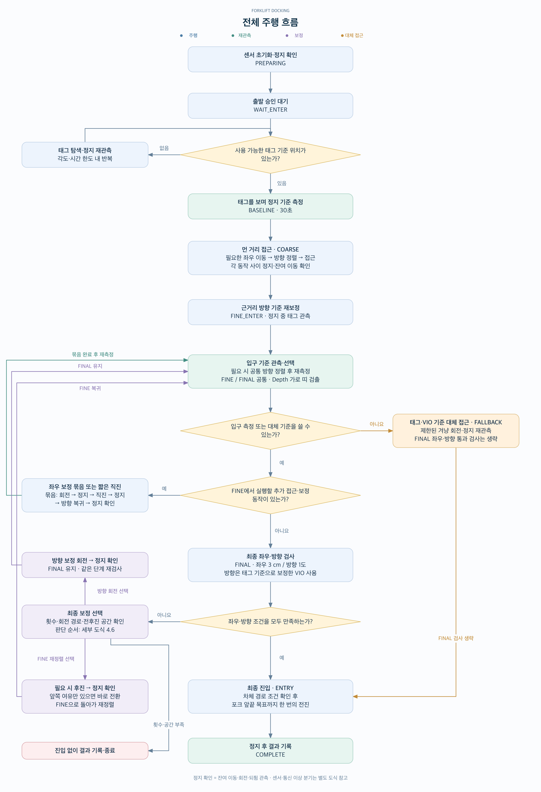
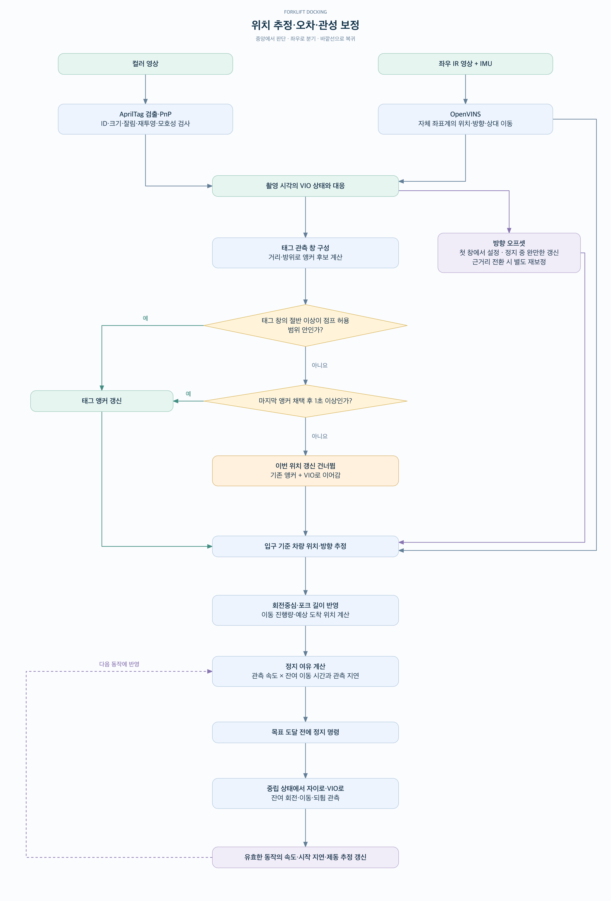
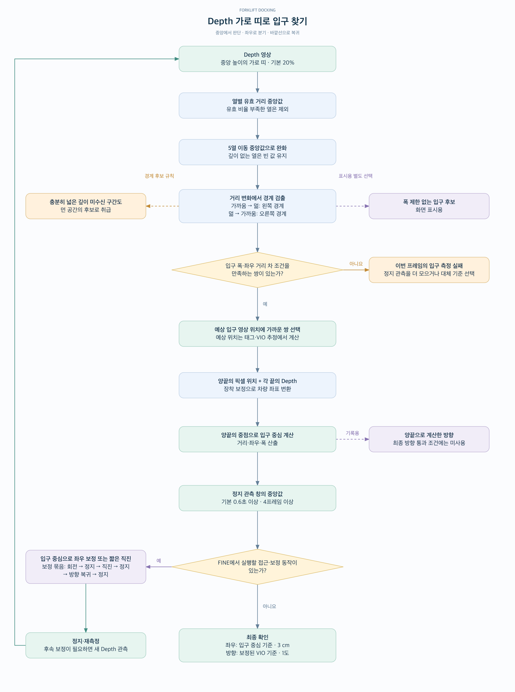
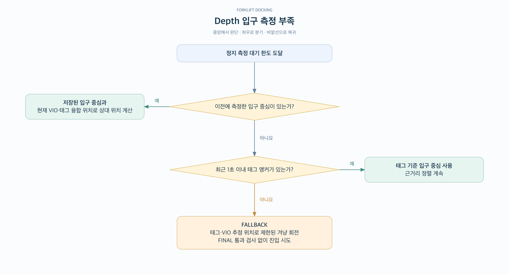
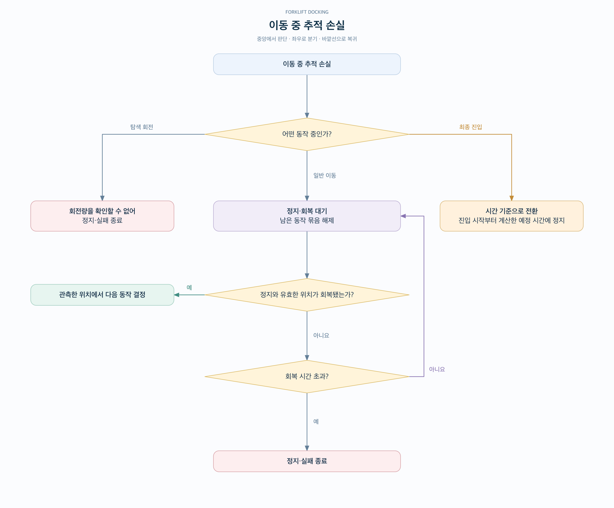
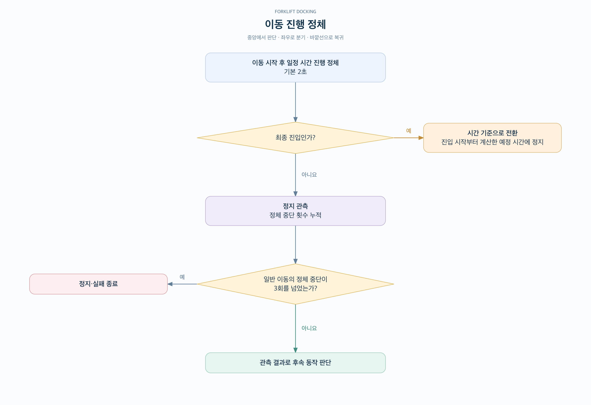
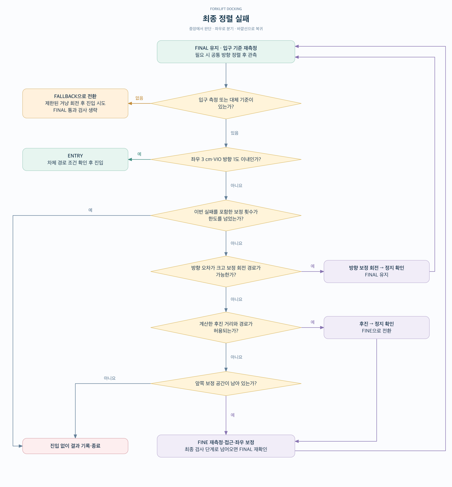

# Forklift Docking · Depth Low Camera

낮게 장착한 카메라의 **Depth 영상에서 입구 양끝을 찾고**, AprilTag와 OpenVINS로 추정한 차량 위치·방향을 이용해 탑재부에 진입하는 지게차 도킹 시스템이다. 먼 거리에서는 태그를 기준으로 접근하고, 가까워지면 Depth로 측정한 입구 중심에 맞춰 좌우를 보정한다.

입구 검출은 **영상 중앙의 가로 띠 → 열별 거리값 → 거리의 급격한 변화 → 좌우 경계 쌍 선택** 순서다. 제어에 쓰는 중심은 이 경계 쌍에서 계산한다. 화면에 표시되는 BEV 격자는 별도의 시각화이며 입구 검출이나 최종 방향 판단에 사용하지 않는다.

- **컬러 영상:** AprilTag의 거리·방위와 방향 기준을 관측한다.
- **좌우 IR 영상 + IMU:** OpenVINS로 상대 이동·회전을 추적한다.
- **Depth:** 가까운 좌우 구조물 사이의 먼 공간 또는 깊이 미수신 구간을 입구 후보로 찾는다.

차량 전방이 x 양수, 차량 왼쪽이 y 양수다. 카메라 장착 위치와 회전중심을 반영하고, 정지 목표는 **포크 앞끝**을 기준으로 계산한다. 현재 설정의 카메라 높이는 0.42 m이며, 현장 치수·태그 위치·모드별 목표는 `configs/common.json`을 따른다.

## 1. 전체 주행 흐름

**준비 → 태그 기준 확보 → 먼 거리 접근(COARSE) → 근거리 정렬(FINE) → 최종 확인(FINAL) → 진입(ENTRY)** 순서로 진행한다. 출발 전 정지 확인과, 출발 승인 후 태그를 보며 수행하는 30초 기준 측정은 별도 단계다.

[확대용 SVG](docs/vis/01-overall-flow.svg) · [도식 원본](docs/vis/01-overall-flow.mmd)

먼 거리에서는 필요한 좌우 이동을 먼저 수행하고 방향을 정렬한 뒤, 예상 태그 잘림 위치보다 앞에서 정지한다. 근거리로 전환할 때는 정지 상태의 태그 관측으로 방향 기준을 다시 보정한다.

근거리 좌우 보정은 **회전 → 정지 확인 → 직진 → 정지 확인 → 방향 복귀 → 정지 확인**의 묶음이다. 두 회전에 따른 차량 위치 변화까지 계산하고, 묶음이 끝나면 실제 관측 위치에서 입구를 다시 측정한다. 정지 확인에는 관성으로 인한 잔여 이동·회전·되튐 관측이 포함된다.

최종 좌우 오차는 입구 중심을 기준으로, 방향 오차는 **태그 기준으로 보정한 VIO 방향과 목표 방향의 차이**로 판단한다. 기본 통과 조건은 좌우 3 cm·방향 1° 이내다. 직진 쏠림 보정값이 설정돼 있으면 목표 방향에 반영한다.

## 2. 위치 추정·오차·관성 보정

태그의 거리·방위로 위치 기준인 **앵커**를 갱신하고, 방향은 **VIO 방향 + 보정 오프셋**으로 계산한다. 태그가 가려지거나 위치 갱신을 건너뛴 구간은 마지막 앵커와 VIO의 상대 이동으로 이어간다.

[확대용 SVG](docs/vis/02-pose-error-correction.svg) · [도식 원본](docs/vis/02-pose-error-correction.mmd)

태그 관측은 0.5초 창에서 3장 이상을 모은다. 창 안의 앵커 후보 중 절반 이상이 점프 허용 범위 안이면 해당 후보들로 갱신한다. 범위 밖 후보가 우세하면 일단 건너뛰지만, 마지막 앵커 채택 후 1초가 지나면 범위 밖 후보들로 갱신하는 분기가 있다. 여러 창이 같은 위치를 반복해서 가리키는지 별도로 확인하는 규칙은 아니다.

위치 점프 허용치는 `max(0.03 m, 태그 거리 × 0.01) + 0.29 m/s × 마지막 채택 이후 시간`이다. 이동 중 방향 오프셋은 유지하며, 정지 중에는 태그 방향을 약하게 반영하고 근거리 전환 시 별도 재보정을 수행한다. 조건을 만족하는 이동 구간에서는 태그 관측과 VIO 궤적으로 장착 yaw 보정도 갱신한다.

직진 진행량은 VIO와 태그 융합 위치의 두 관측 중 더 진행한 쪽을 이용해 정지를 판단한다. 관측 속도, 제동 후 잔여 이동 시간, 관측 지연으로 정지 여유를 계산해 목표 전에 중립 명령을 보낸다. 유효하게 관측한 동작의 속도·시작 지연·제동 추정은 다음 정지 판단에 반영하며, 이 추정으로 현재 측정 위치를 덮어쓰지는 않는다.

정지는 중립 명령, 바이어스를 뺀 자이로, VIO 이동 속도로 판단한다. VIO 속도를 계산하지 못하면 중립 이후 경과 시간을 대체 기준으로 사용한다. 기록되는 `σ`는 최종 진입의 통과 조건이 아니다.

## 3. Depth 가로 띠로 입구 찾기

영상 중앙 높이의 가로 띠에서 각 열의 유효 Depth 중앙값을 구해 **1차원 거리 곡선**을 만든다. 이 곡선에서 **가까움 → 멂 → 가까움**이 나타나는 구간을 좌우 경계 쌍으로 찾는다.

[확대용 SVG](docs/vis/03-depth-entrance.svg) · [도식 원본](docs/vis/03-depth-entrance.mmd)

가로 띠는 기본적으로 영상 높이의 20%다. 열별 유효 비율이 부족하면 제외하고, 5열 이동 중앙값으로 거리 곡선을 완화한다. 깊이가 없는 열을 임의의 거리로 채우지는 않는다. 다만 폭이 충분한 깊이 미수신 구간은 먼 공간의 후보로 취급하므로, 후보라는 사실만으로 실제 입구가 확정되지는 않는다.

제어용 후보는 설정된 탑재부 폭과의 차이가 허용치 이내여야 하며, 좌우 경계의 거리 차도 허용 범위 안이어야 한다. 거리 차 허용치에는 측정 여유와 차량이 비스듬할 때의 기하학적 차이를 반영한다. 통과한 쌍 중 태그·VIO 위치로 예상한 입구 영상 위치에 가장 가까운 쌍을 선택한다.

양끝의 픽셀 위치와 각 끝의 Depth를 차량 좌표로 변환하고 그 중점을 입구 중심으로 사용한다. **양끝에서 계산한 방향(`pair_heading_deg`)은 기록되지만 최종 방향 통과 조건에는 사용하지 않는다.** 최종 방향 판단은 VIO 기반이며, 별도의 옆판 주축 추정은 수행하지 않는다.

정지 측정은 기본 0.6초 이상·4프레임 이상을 모아 중앙값을 사용한다. 제어에 채택하는 입구 측정 거리는 최대 4.5 m다. 좌우 보정 직진 중에도 새 Depth 관측으로 방향 복귀 후의 예상 좌우 오차를 계산하고, 중심에 도달하면 직진을 일찍 끝낸다. 마지막 확인 거리는 입구 양끝이 Depth 시야 안에 남는 거리와 포크 길이를 반영한다.

폭 제한 없이 뽑는 화면용 후보와 누적 BEV 격자는 표시용이다. 검출 띠가 입구 양끝을 실제로 가로질러야 하므로, 카메라 높이·기울기와 구조물 높이가 관측 가능 여부에 영향을 준다.

## 4. 관측 실패·정렬 실패 시 분기

### 4.1. 태그 기준이 없거나 태그가 사라졌을 때

기준 위치를 확보하기 전에는 정지 재관측 또는 분할 회전 탐색을 수행한다. 기준이 있으면 마지막 앵커와 VIO로 위치 추정을 이어가며, 일반 제어에서는 시간·이동거리 한도를 적용한다.

[확대용 SVG](docs/vis/04a-tag-loss.svg) · [도식 원본](docs/vis/04a-tag-loss.mmd)

### 4.2. Depth에서 입구를 찾지 못했을 때

정지 측정 대기 한도까지 충분한 관측을 모으지 못하면 **저장된 입구 중심 → 최근 태그 앵커 → 대체 접근(FALLBACK)** 순서로 기준을 선택한다.

[확대용 SVG](docs/vis/04b-depth-missing.svg) · [도식 원본](docs/vis/04b-depth-missing.mmd)

### 4.3. 이동 중 추적을 잃었을 때

탐색 회전은 정지·실패 종료하고, 일반 이동은 남은 동작 묶음을 해제한 뒤 정지·회복 대기로 전환한다. 최종 진입은 예정 시간으로 종료를 판단하는 예외가 있으며, 이때도 별도 IMU·CAN 감시는 계속된다.

[확대용 SVG](docs/vis/04c-tracking-loss.svg) · [도식 원본](docs/vis/04c-tracking-loss.mmd)

### 4.4. 이동 진행이 정체됐을 때

이동이 관측된 뒤 진행량이 일정 시간 늘지 않으면 정체로 판단한다. 일반 직진은 정지 후 후속 동작을 판단하고, 최종 진입은 시간 기준으로 전환한다.

[확대용 SVG](docs/vis/04d-no-progress.svg) · [도식 원본](docs/vis/04d-no-progress.mmd)

### 4.5. IMU·CAN 감시 이상

IMU 이상은 정지·추적 회복 처리로, CAN 송신 경로 이상은 정지·종료로 이어진다. IMU 감시는 최종 진입 중에도 적용된다.

[확대용 SVG](docs/vis/04e-imu-can-fault.svg) · [도식 원본](docs/vis/04e-imu-can-fault.mmd)

### 4.6. 최종 좌우·방향 정렬 실패

보정 횟수 한도를 확인한 뒤 **방향 보정 회전 → 후진 가능 여부 → 앞쪽 보정 공간** 순서로 판단한다. 방향 회전만 하면 `FINAL`을 유지하고, 후진하거나 앞쪽 공간으로 다시 정렬할 때는 `FINE`으로 돌아간다.

[확대용 SVG](docs/vis/04f-final-alignment.svg) · [도식 원본](docs/vis/04f-final-alignment.mmd)

재측정에서도 입구 기준을 확보하지 못하면 `FALLBACK`으로 전환한다. 이 분기는 제한된 겨냥 회전 후 진입하며, 정상 `FINAL`의 좌우·방향 동시 통과 검사를 생략한다. 예상 도착 좌우 판정은 기록하지만 그 판정이 거짓이라는 이유만으로 진입을 막지는 않는다. 진입 경로에는 설정된 차체·탑재부 경계 검사가 적용된다.

목표 거리를 이미 지난 경우에는 공간이 허용하면 한 번 후진하고, 후진하지 못하면 결과를 기록하고 끝낸다. `COMPLETE`에는 진입하지 않고 종료한 경우도 포함된다.

현재 주요 한도는 준비 180초, 출발 승인 후 전체 주행 600초, 태그 탐색 180초·최대 한 바퀴, 정지 재관측 20초, 추적 회복 60초다. 탐색 간격은 50°이며, 회복 시간은 정지 재관측에서 넘어온 경우 원래 정지 시점부터 계산한다. 근거리 방향 재보정은 8초 이내에 끝나지 않아도 기존 기준으로 진행한다. 일반 직진의 진행 정체 기준은 2초이고, 정체 중단이 3회를 넘으면 종료한다. 개별 동작의 시간 상한은 설정값과 예상 동작 시간을 함께 사용한다.

도식의 허용치는 현재 제어 규칙이며 실측 정확도 보증값은 아니다. Depth 미수신 구간, 시간 기준 진입, 표시용 후보와 제어용 입구 중심을 구분해서 결과를 해석해야 한다.

**구현 위치:** 흐름·예외 처리는 `docking/controller.py`, Depth 입구 검출은 `docking/depth_goal.py`, 센서 처리는 `docking/camera.py`, 위치 융합은 `docking/fusion.py`·`docking/observer.py`, 보정 기하는 `docking/fine.py`, 정지 판단은 `docking/stationary.py`에 있다.
